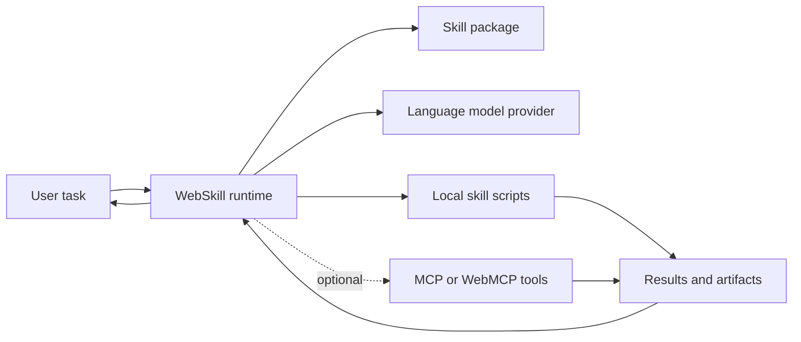

# WebSkill API

_Draft Proposal, October 2026_

**This version:** [EXPLAINER.md](EXPLAINER.md)  
**Issue tracking:** [GitHub issues](https://github.com/kevinmoch/web-skill/issues)  
**Editors:** Chunhui Mo (Huawei)  
**Translations:** [简体中文](EXPLAINER.zh-CN.md)

## Status of this document

This is an early explainer for discussion. It is not a W3C Standard, and it is not on the W3C Standards Track.

The current TypeScript SDK is a reference implementation and source of implementation experience. It is not a native browser implementation of the API proposed here. Statements about the SDK describe what exists today; statements about `navigator.webskill` as a browser-provided API describe the proposal.

## Table of Contents

1. [Introduction](#1-introduction)
2. [User-Facing Problem](#2-user-facing-problem)
3. [Motivating Use Cases](#3-motivating-use-cases)
4. [Goals](#4-goals)
5. [Non-Goals](#5-non-goals)
6. [User Research and Implementation Evidence](#6-user-research-and-implementation-evidence)
7. [Terminology and Standardization Scope](#7-terminology-and-standardization-scope)
8. [Proposed Approach](#8-proposed-approach)
9. [Practical Examples](#9-practical-examples)
10. [Detailed Design](#10-detailed-design)
11. [Dependencies on Other Features](#11-dependencies-on-other-features)
12. [Alternatives Considered](#12-alternatives-considered)
13. [Accessibility, Internationalization, Privacy, and Security Considerations](#13-accessibility-internationalization-privacy-and-security-considerations)
14. [Interoperability, Testability, and Implementation Experience](#14-interoperability-testability-and-implementation-experience)
15. [Stakeholder Feedback / Opposition](#15-stakeholder-feedback--opposition)
16. [Open Questions](#16-open-questions)
17. [References & Acknowledgements](#17-references--acknowledgements)

- [Appendix A. Proposed Web IDL](#appendix-a-proposed-web-idl)
- [Appendix B. Current SDK Capability Mapping](#appendix-b-current-sdk-capability-mapping)

## 1. Introduction

Agent Skills package domain knowledge and repeatable workflows in a portable directory. WebSkill proposes a web platform API for discovering, validating, running, installing, and removing those skills. Its initial entry point is `navigator.webskill`.

A WebSkill is more than a prompt and more than a collection of external tools. Its `SKILL.md` tells an agent how to approach a task, while its optional `scripts/` provide deterministic executable capabilities. Local scripts are first-class execution units and do **not** require MCP or WebMCP. MCP and WebMCP integrations extend a skill when page-provided or remote capabilities are also needed.



_Text alternative:_ a user task enters the WebSkill runtime. The runtime uses a skill package and a language model, then calls local skill scripts. MCP or WebMCP tools are optional side paths. Script and tool results return to the runtime before the final response reaches the user.

## 2. User-Facing Problem

People regularly ask AI systems to perform specialized, multi-step work: apply an organization's review rules, analyze a spreadsheet, fill a document template, or follow an internal approval process. Today they often repeat the same background information, receive inconsistent procedures, and have limited visibility into what the agent did.

Web developers face a related platform gap. Each application that wants reusable skills must assemble its own parser, catalog, router, script executor, permission UX, artifact store, and run tracker. Skills become coupled to one agent product, while eagerly loading every instruction and tool description consumes context and makes tool selection less reliable.

There is also no uniform browser API for the skill lifecycle. A developer who wants to discover a skill, validate it, execute its local scripts, and later remove it must currently choose or build a complete runtime. WebSkill addresses that missing layer; it does not attempt to replace language model APIs or tool protocols.

## 3. Motivating Use Cases

### 3.1 Reusable Domain Workflows

A company packages its expense-review rules, document templates, and validation scripts as one skill. Employees can invoke the same reviewed procedure in any compatible Web application instead of copying prompts and reimplementing the workflow.

### 3.2 Self-Contained Script Execution

A reporting skill includes a script that calculates totals and writes a result file. The agent activates the skill and executes that script locally. No MCP server, WebMCP registration, or remote tool is involved. This is the baseline execution model, not a degenerate case.

### 3.3 Local and Privacy-Sensitive Processing

A user analyzes a local business document and creates an artifact on their device. The host can use an on-device model and deny network access to the script. A different host may use a cloud model or approved remote data sources, so local processing is an option and policy choice, not an unconditional guarantee.

### 3.4 Human-in-the-Loop Execution

An agent discovers that a required parameter is missing and presents a form. Before a script reads a sensitive resource or calls an approved external capability, the user can review a confirmation. Long-running work can expose progress, cancellation, interruption, and resumable state.

### 3.5 Hybrid Skills with External Tools

An inventory skill uses a local script for deterministic calculations, an MCP endpoint for inventory records, and a WebMCP tool for page-specific state. A common tool-definition and result vocabulary lets the runtime compose these sources without making them interchangeable trust boundaries.

### 3.6 Page-Scoped Temporary Skills

A complex enterprise application has different business rules on different pages. The current page exposes only the relevant instructions, resources, and tools through MCP. When the page or endpoint is removed, those temporary skills disappear from the catalog instead of accumulating in persistent storage.

### 3.7 Skill Distribution and Management

A user installs a reviewed skill archive, inspects validation and integrity information, runs it with limited capabilities, and uninstalls it when it is no longer needed. Versioning, signatures, and organizational approval can build on the same lifecycle.

## 4. Goals

- Provide a uniform, interoperable browser API for the WebSkill lifecycle.
- Reuse the open Agent Skills format rather than create an incompatible package ecosystem.
- Support progressive disclosure of metadata, instructions, and resources.
- Treat scripts bundled with a skill as first-class execution units.
- Give local scripts and external tools compatible JSON Schema and content-result vocabularies.
- Support multi-turn agent execution, structured tool errors, observable runs, and artifacts.
- Support instruction-only, script-backed, external-tool-backed, and hybrid skills.
- Keep model providers, executors, UI frameworks, storage, MCP, and WebMCP replaceable.
- Give users meaningful inspection, approval, cancellation, and removal controls.
- Separate deterministic, testable platform behavior from model quality and output variability.

## 5. Non-Goals

- Define a new language model API or replace the Prompt API.
- Require MCP or WebMCP for WebSkill execution.
- Treat MCP-compatible data shapes as use of the MCP wire protocol.
- Replace MCP or WebMCP tool registration and invocation.
- Require every browser or device to ship a language model.
- Mandate on-device inference, offline operation, zero network egress, or absolute privacy.
- Guarantee model output quality, identical skill selection, or identical natural-language results across implementations.
- Require TypeScript inference in every user agent.
- Claim that an ordinary Web Worker, by itself, safely contains every untrusted script.
- Standardize Node.js-only host APIs as web platform APIs.
- Standardize the SDK's complete Chatbot, Console, UI component, sub-agent, evaluation, and governance products in the initial proposal.
- Require every implementation to support the optional MCP binding for page-scoped skills.

## 6. User Research and Implementation Evidence

No independent, representative end-user research study has yet been conducted for this proposal. That evidence gap should remain explicit rather than be replaced with anecdotes or invented survey results.

The current `@webskill/sdk` provides implementation evidence for the main workflows. Its browser and Node hosts share core protocol and runtime layers. Existing examples and behavioral tests cover local script execution without MCP, MCP/WebMCP tool integration, interaction, artifacts, tracing, installation, and page-scoped temporary skills. These demonstrate feasibility, not market demand or browser consensus.

The reference implementation also exposes areas where a standard needs sharper boundaries: schema inference versus explicit schemas, multiple sandbox strengths, model-dependent behavior, result normalization, and the difference between a stable core and experimental host capabilities.

## 7. Terminology and Standardization Scope

### 7.1 Terminology

- **Skill**: a portable unit of instructions and optional executable or reference resources.
- **Skill package**: a directory containing `SKILL.md` and optional `scripts/`, `references/`, and `assets/`.
- **Catalog**: metadata discovered from the available skill packages.
- **Run**: one observable execution initiated through `run()`.
- **Script**: an ES module in a skill's `scripts/` directory that can be exposed as a tool.
- **Tool definition**: the name, description, input schema, source, and owning skill used by the agent.
- **Artifact**: a file or other durable output associated with a run.
- **Interaction**: a form, confirmation, selection, file choice, or authorization request presented to a user.
- **Page-scoped temporary skill**: a skill projected through a live page endpoint and removed when that endpoint disappears.

### 7.2 Three Layers

This explainer distinguishes:

1. The Agent Skills file and directory format.
2. The proposed browser API, script contract, and runtime semantics.
3. SDK-specific hosts, user interfaces, governance features, and integrations.

Only the second layer is the direct subject of this API proposal. The first is an external dependency, and the third provides implementation evidence and possible future work.

### 7.3 Initial Core API Scope

The initial facade contains six operations:

- `discover(path)`
- `read(name)`
- `validate(path)`
- `run(prompt)`
- `install(url)`
- `uninstall(name)`

The local script contract is part of the core execution model even though it is an ES module convention rather than another method on this facade.

### 7.4 Core and Optional Capabilities

- **Core:** discovery, reading, validation, running, local script execution, installation, and removal.
- **Optional extensions:** MCP, WebMCP, generative UI, and page-scoped temporary skills.
- **Possible later or separate proposals:** page actuation, sub-agent delegation, governance, and organization-wide audit systems.

## 8. Proposed Approach

This section describes the approach without Web IDL. The draft IDL is isolated in [Appendix A](#appendix-a-proposed-web-idl).

### 8.1 Navigator Entry Point

A browser would expose a read-only `navigator.webskill` object. The object provides a stable facade while allowing different implementations of model access, script isolation, storage, and user interaction.

Feature detection and capability failure must be normal paths. A browser can implement the facade while reporting that no model or no suitable script executor is available.

### 8.2 Skill Package Model

A skill package uses the familiar Agent Skills layout:

```text
my-skill/
├── SKILL.md
├── scripts/       # optional executable modules
├── references/    # optional documents loaded on demand
└── assets/        # optional templates and other resources
```

`SKILL.md` contains metadata and instructions. Metadata identifies the skill and describes when it is relevant; the body tells the agent how to perform the workflow. Declarative fields such as dependencies and allowed tools can further constrain activation and execution.

### 8.3 Progressive Disclosure and Skill Activation

Discovery exposes only the metadata needed for routing. When a task matches a skill, the runtime reads its full instructions and activates its declared capabilities. Scripts, references, and assets are loaded only when required.

This limits the initial context footprint. It also creates a clear activation point for integrity checks, tool registration, and policy enforcement.

### 8.4 Discovery, Reading, and Validation

`discover()` returns a catalog of available skills. `read()` returns one skill's metadata, instruction body, and location. `validate()` reports structural and semantic issues without requiring an agent run.

Validation covers items such as missing or malformed `SKILL.md`, invalid names, duplicates, unsupported script files, unknown dependencies, and dependency cycles. Implementations should distinguish a bad skill that can be excluded from a failure that prevents discovery altogether.

### 8.5 Running Skills

`run()` starts an agent loop. The runtime routes the user task, activates relevant skills, exposes the appropriate tools, and iterates with a model until completion or a defined terminal condition.

Tool failures become structured results that can be fed back to the model for correction. Timeouts, excessive turns, cancellation, unavailable capabilities, and authorization denial remain distinguishable from model output.

### 8.6 Execution Models and Protocol Independence

WebSkill supports several execution models:

| Model            | Capability source              | Requires MCP/WebMCP?        |
| ---------------- | ------------------------------ | --------------------------- |
| Instruction-only | `SKILL.md` and model reasoning | No                          |
| Script-backed    | Local modules under `scripts/` | No                          |
| MCP-backed       | Tools from an MCP endpoint     | MCP                         |
| WebMCP-backed    | Tools registered by a page     | WebMCP                      |
| Hybrid           | A combination of the above     | Only for the external parts |

Local scripts and MCP tools deliberately share parts of their vocabulary, notably JSON Schema inputs and content-based results. This makes routing and adaptation easier. It does not turn a local script into an MCP server or add an MCP transport to its execution path.

### 8.7 Skill Scripts as First-Class Execution Units

Each eligible script can become a tool after its owning skill is activated. A namespaced tool name, such as `sales__total`, prevents collisions between scripts in different skills.

Scripts perform deterministic work that is inappropriate or unreliable for a model: arithmetic, transformation, template processing, validation, and artifact generation. They receive a controlled execution context rather than implicit access to the entire host.

### 8.8 Script Module Contract

The reference contract is an ES module with these exports:

- `run(input, context)` is required at execution time and may be asynchronous.
- `description` is an optional human- and model-readable tool description.
- `inputSchema` describes `input` using JSON Schema.

JavaScript is the interoperability baseline. TypeScript can be supported through host-provided transpilation. The SDK also supports sidecar schemas and best-effort TypeScript/JSDoc inference; those are authoring conveniences and need not be required from every browser.

A script returns an MCP-compatible `content` array, or a value that the runtime normalizes into one. The runtime adds a success flag, structured error information, and artifact metadata around that content. This outer `ToolResult` is related to, but not identical to, MCP's complete `CallToolResult` and wire protocol.

### 8.9 Human Interaction and Observable Runs

The runtime can request missing parameters, confirmations, selections, files, or capability authorization through a UI bridge. Forms are derived from structured schemas rather than from arbitrary script-controlled HTML.

A run exposes status, active skills, lifecycle events, tool calls, warnings, and artifacts. Hosts can add cancellation, interruption, resume, and streaming while preserving a common terminal-state model.

### 8.10 Skill Installation and Removal

`install()` retrieves a supported skill source, validates and unpacks it, checks policy, and records an installation manifest with integrity information. `uninstall()` removes the managed skill and its associated local state according to host policy.

The core API does not require every source type used by the SDK. HTTP archives, Git repositories, local paths, package registries, updates, signatures, and trust stores need explicit scope decisions.

### 8.11 Optional External Tool Integration

MCP and WebMCP tools can be registered as additional tool sources. They share the runtime's routing and result normalization with local scripts, while retaining source identity, visibility settings, `allowed-tools` restrictions, and separate authorization decisions.

An unavailable external endpoint does not make local scripts inherently unavailable. Implementations should report which source failed rather than collapse every failure into a generic tool error.

### 8.12 Optional Page-Scoped Skills over MCP

A page can act as an MCP server and project a temporary skill through three MCP primitives:

- the `SKILL.md` instruction body as an MCP prompt;
- executable capabilities as MCP tools;
- references and assets as MCP resources.

The runtime acts as an MCP client, merges the temporary entries into its catalog with source information, reads the prompt and resources on demand, and calls the tools through the endpoint. Unregistering the endpoint removes the skills; they are not added to persistent skill storage.

MCP does not itself define a “page-scoped skill.” This mapping is a WebSkill application-layer profile. Likewise, the SDK's `MessageChannelTransport` is a web-oriented transport adapter, not a transport required by this proposal or by MCP. The entire binding is optional.

### 8.13 Runtime Architecture and Host Adaptation

The SDK separates environment-neutral protocol and runtime code from Node and browser hosts. Browser implementations can use OPFS for origin-private storage, isolated Workers or opaque-origin iframes for execution, and host-provided bridges for interaction and artifacts.

These are implementation choices with different security properties. The proposed API should specify required behavior and boundaries without pretending that every sandbox mechanism provides equivalent isolation.

## 9. Practical Examples

The examples use JavaScript. The browser API examples show the proposal; the MCP assembly example is explicitly based on the current SDK.

### 9.1 Feature Detection and Graceful Degradation

```js
const ws = navigator.webskill;

if (!ws) {
  // Use the application's existing non-WebSkill workflow instead.
} else {
  // Use ws.discover(), ws.read(), ws.validate(), or ws.run().
}
```

Applications should also handle rejected operations caused by an unavailable model, executor, storage backend, or permission.

### 9.2 Discover, Read, and Validate Skills

```js
const catalog = await ws.discover('/skills');
console.log(catalog.entries.map((entry) => entry.name));

const skill = await ws.read('sales');
console.log(skill.metadata.description, skill.body);

const report = await ws.validate('/skills');
if (!report.ok) {
  for (const issue of report.issues) console.warn(issue.code, issue.message);
}
```

### 9.3 Run a Self-Contained Script-Backed Skill

The following package needs no MCP or WebMCP integration.

```md
---
name: sales
description: Calculate deterministic sales totals and save the result
---

# Sales

For a sales total, call `sales__total` with the supplied amounts.
```

```js
// scripts/total.js
export const description = 'Calculate a total and store it as a run artifact.';

export const inputSchema = {
  type: 'object',
  properties: {
    amounts: {
      type: 'array',
      items: { type: 'number' },
      description: 'Amounts to add together'
    }
  },
  required: ['amounts']
};

export async function run(input, context) {
  const total = input.amounts.reduce((sum, value) => sum + value, 0);
  await context.writeArtifact('total.json', JSON.stringify({ total }), {
    mimeType: 'application/json'
  });
  return [{ type: 'text', text: `Total: ${total}` }];
}
```

```js
const run = await ws.run('Use the sales skill to total 12.5, 7.5, and 20.');
console.log(run.status, run.activeSkillNames);
```

The script performs the calculation; the model selects and interprets the skill. There is no tool server in this path.

### 9.4 Inspect Run Status, Trace, and Artifacts

```js
console.log(run.id, run.status, run.phase);
console.log(run.trace);
console.log(run.artifacts);
```

The current core facade returns a `RuntimeRun`. Whether the standardized run result should also directly expose final text, streaming, or a separate result object remains an open question.

### 9.5 Human-in-the-Loop Interaction

A script can request a host-mediated confirmation through its restricted context:

```js
export async function run(input, context) {
  const approved = await context.confirm('Write the validated report artifact?');
  if (!approved) return [{ type: 'text', text: 'The user declined the write.' }];

  const artifact = await context.writeArtifact('report.txt', input.report, {
    mimeType: 'text/plain'
  });
  return [{ type: 'text', text: `Created ${artifact.path}.` }];
}
```

The host decides how to present the request. It must not let the script synthesize a trusted browser permission prompt.

### 9.6 Install and Uninstall a Skill

```js
const installed = await ws.install('https://example.com/skills/sales.zip');
console.log(installed.name, installed.integrity.digest);

await ws.uninstall(installed.name);
```

Installation and removal may require user approval and may reject unsupported sources. The URL in this example is illustrative, not a hosted test fixture.

### 9.7 Hybrid Skill with MCP or WebMCP Tools

A skill can narrow its tool surface while combining local and external sources:

```yaml
allowed-tools:
  - total
  - endpoint:inventory/lookup
  - mcp#current_product
```

Here `total` is a script in the declaring skill, `endpoint:inventory/lookup` is an MCP tool, and `mcp#current_product` is a WebMCP tool. The local script remains usable if neither external integration is configured, although a workflow that explicitly needs external data may then be incomplete.

### 9.8 Register a Page-Scoped Temporary Skill over MCP

This example uses the current SDK's optional binding, not a new method on the proposed core facade.

```js
import { McpServer } from '@modelcontextprotocol/sdk/server/mcp.js';
import { MessageChannelTransport, serveSkillAsMcp } from '@webskill/sdk/mcp';

const server = new McpServer({ name: 'page-server', version: '0.1.0' });

await serveSkillAsMcp(server, {
  name: 'analyze-table',
  description: 'Analyze the table on the current page using its business rules',
  body: '# Analysis rules\nAsk for the table data, then call analyze.',
  resources: [
    {
      uri: 'skill://analyze-table/references/fields',
      name: 'fields',
      text: 'Field definitions and aggregation rules',
      mimeType: 'text/plain'
    }
  ],
  tools: [
    {
      name: 'analyze',
      description: 'Calculate the page-defined aggregates',
      inputSchema: { type: 'object', properties: {} },
      handler: async () => ({
        content: [{ type: 'text', text: '{"total":40}' }]
      })
    }
  ]
});

const channel = new MessageChannel();
// Transfer channel.port2 to the runtime and register its endpoint as "page".
await server.connect(new MessageChannelTransport(channel.port1));

// On page teardown, close the server and unregister "page" in the runtime.
```

The channel wiring is shown separately because it belongs to the host integration. The important point is that the page supplies a prompt, resources, and tools whose visibility ends with the endpoint.

## 10. Detailed Design

### 10.1 API Data Model

The core data model includes `SkillCatalog`, `SkillCatalogEntry`, `SkillDocument`, `SkillMetadata`, `ValidationReport`, `RuntimeRun`, `InstalledSkillManifest`, `ToolDefinition`, `ToolResult`, and `Artifact`.

These objects describe platform state rather than model-generated natural language. Their deterministic fields are candidates for interoperability tests.

### 10.2 Script Tool Definition and Result Mapping

A script tool has a namespaced name, optional description, JSON Schema input, source `script`, and owning skill. The current SDK resolves an absent explicit schema through a sidecar and then best-effort inference before marking it unavailable.

Return values are normalized into content parts. The SDK's outer `ToolResult` uses `ok`, optional structured `error`, and optional `artifacts`. MCP uses related but non-identical result semantics, including its own error and structured-content fields. A standard should define a deliberate mapping rather than claim that the shapes are already identical.

### 10.3 Origin, Storage, and Visibility

Skills must have a clear owner and visibility scope. The reference browser host uses OPFS for origin-private persistent skills. Page-scoped skills instead inherit the lifetime of their endpoint and are not written into that store.

Cross-origin sharing, browser-managed user-level libraries, and synchronization are not default behavior. They introduce identity, permission, and privacy questions beyond the initial core.

### 10.4 Execution Lifecycle

A run moves through routing, activation, preparation, execution, interaction, and a terminal state. Cancellation, user interruption, expiry, total timeout, per-tool timeout, and turn limits need distinct observable outcomes.

Hosts may persist resumable snapshots, but snapshot formats and cross-version migration should not be frozen prematurely.

### 10.5 Script Isolation and Capability Bridge

Both definition loading and execution of an untrusted script should occur in the isolated environment; the host should not first import the module into its own trusted realm.

The context exposes narrow capabilities such as `readReference`, `readAsset`, `writeArtifact`, approved data access, and `confirm`. Each capability can be disabled or require approval. Network access needs its own policy and must not be inferred from file access.

The SDK has isolation-grade and weaker capability-tier executors. A standard must make the chosen boundary auditable and must not describe every Worker-based executor as an equivalent security boundary.

### 10.6 Installation and Supply-Chain Semantics

Installers need defenses against path traversal, absolute paths, decompression bombs, oversized files, and unsupported content. Manifests can record per-file hashes and a package digest. Signatures, trusted keys, unsigned-skill policy, activation-time verification, quarantine, and rollback provide additional supply-chain controls.

Automatic updates are not assumed. They require separate consent and failure-recovery rules.

### 10.7 Permissions and Capability Control

Secure-context requirements, Permissions Policy, iframe delegation, and Worker exposure need an explicit model. Tool permission is not a replacement for user activation or authorization of the underlying sensitive capability.

`allowed-tools` can reduce which scripts and external tools a skill exposes. User approval should identify the skill, capability, target, and scope without training users to approve repetitive prompts blindly.

### 10.8 Errors and Events

The SDK uses `WebSkillError` and stable string error codes for programmatic handling. A web platform version must decide how these map to `DOMException`, custom error objects, and rejected promises.

Errors should distinguish malformed skills, unavailable models, denied capabilities, blocked network access, tool failure, timeouts, cancellation, installation failure, integrity failure, and endpoint loss. Lifecycle events should make these transitions observable without exposing secrets.

### 10.9 Optional MCP Skill Profile

A formal profile would need to define skill identity, prompt naming, resource URI conventions, tool ownership, source metadata, endpoint lifecycle, conflicts, and result mapping. Transport selection should remain separate from skill semantics.

Without such a profile, the mapping in this explainer should be treated as an interoperable SDK binding, not as behavior guaranteed by arbitrary MCP clients and servers.

### 10.10 Extensibility

Model clients, script executors, storage backends, UI bridges, MCP/WebMCP sources, and governance services are extension points. Their inclusion in the SDK does not make all of them necessary browser APIs.

## 11. Dependencies on Other Features

### 11.1 Core Dependencies

The proposal builds on Promises, ES modules, Workers, an origin-private storage mechanism such as OPFS, Web Crypto, and the Agent Skills format. Exact availability and fallback behavior need specification rather than an assumption that every device has identical support.

### 11.2 Local Script Execution

Local script execution does not depend on MCP or WebMCP. JavaScript is the baseline module format. TypeScript transpilation and schema inference are optional host conveniences.

JSON Schema and MCP-shaped content provide a useful shared vocabulary; neither creates a network or transport dependency.

### 11.3 Optional Integrations

The Prompt API or another model interface can supply reasoning. MCP and WebMCP can supply external capabilities. Generative UI protocols can render interaction and results. These integrations must remain optional because some are still evolving or lack multi-engine implementations.

## 12. Alternatives Considered

| Alternative                               | Benefit                                                      | Limitation and reason not preferred                                                                                                                                                  |
| ----------------------------------------- | ------------------------------------------------------------ | ------------------------------------------------------------------------------------------------------------------------------------------------------------------------------------ |
| JavaScript SDK only                       | No browser changes; fast experimentation                     | Every host must bundle and update the runtime; native lifecycle, permission, and interoperability behavior remains fragmented. The SDK remains valuable as a reference and polyfill. |
| Prompt API only                           | Direct model access is simple                                | It does not define skill packages, discovery, local execution, installation, or governance of agent workflows.                                                                       |
| MCP/WebMCP only                           | Strong tool interoperability                                 | A tool does not package instructions, references, progressive disclosure, and the complete skill lifecycle. These protocols are complements.                                         |
| Server-side runtime only                  | Central operations and existing sandbox infrastructure       | Requires a backend, moves data off device, and duplicates client state for browser-centric workflows.                                                                                |
| Declarative skills only                   | Smaller executable attack surface                            | Cannot express deterministic computation and artifact generation without another execution mechanism.                                                                                |
| Local scripts only                        | Simple, self-contained packages                              | Cannot reuse page or remote capabilities when a task needs them.                                                                                                                     |
| External tools only                       | No local script sandbox required                             | Makes every skill dependent on an external integration and loses self-contained execution.                                                                                           |
| High-level `run()` plus lifecycle methods | Matches complete user tasks and the reference implementation | More runtime behavior must be specified than for discovery alone; this trade-off needs review.                                                                                       |
| Direct page-skill registration API        | Avoids an MCP mapping                                        | Adds another registration protocol and overlaps with existing MCP prompt/tool/resource infrastructure. The MCP binding is therefore explored first as an option.                     |
| Browser-wide shared skill library         | Skills follow the user across sites                          | Cross-origin identity, consent, privacy, and trust become substantially harder; origin-scoped storage is the safer initial baseline.                                                 |

Naming alternatives, including `navigator.webskill` versus multiple global interfaces, should remain open to TAG and WebIDL review.

## 13. Accessibility, Internationalization, Privacy, and Security Considerations

### 13.1 Accessibility

Forms, confirmations, authorization requests, progress, errors, and cancellation must be keyboard and assistive-technology accessible. Generated charts need text alternatives, and artifacts need meaningful names and types.

Agent assistance must not bypass the accessibility of the underlying application. A tool-based path can reduce brittle visual automation, but it does not itself make an inaccessible page accessible.

### 13.2 Internationalization

Skill metadata, instructions, schemas, and interaction messages may be authored in any language. Hosts must localize their own UI and errors rather than translate or rewrite a skill's text without attribution.

Model language support and output quality remain implementation-dependent. Machine-readable identifiers and error codes should not depend on translated text.

### 13.3 Privacy

The API can involve prompts, page content, files, skill resources, memory, traces, and artifacts. Implementations must make the relevant data flow visible, especially when a remote model or endpoint is used.

OPFS provides origin-private storage, not automatic confidentiality from the same origin, a malicious installed skill, or an authorized remote service. Persisted traces and profiles need retention, deletion, export, and redaction policies. Cross-site skill and profile synchronization is outside the initial scope.

### 13.4 Security

The threat model includes malicious packages and scripts, prompt injection in instructions and resources, hostile tool results, supply-chain substitution, path traversal, resource exhaustion, network exfiltration, secret capture, and confused-deputy behavior across MCP or frames.

Required mitigations include isolated loading and execution, narrow capability bridges, deny-by-default network policy where appropriate, path and archive limits, integrity and signature checks, source-aware authorization, structured audit events, and redaction of sensitive arguments.

Page-scoped skills add requirements for origin validation, endpoint registration and removal, navigation handling, and protection against stale tools. User confirmation must identify the real requesting skill and target. No single mitigation—including a Worker, OPFS, a signature, or a confirmation dialog—is sufficient by itself.

## 14. Interoperability, Testability, and Implementation Experience

Deterministic behavior is suitable for specification and web-platform tests: package parsing, catalog construction, validation, script export handling, schema mapping, result normalization, manifests, lifecycle transitions, permissions, and errors. Mock models can make end-to-end run behavior deterministic.

Natural-language quality, model reasoning, and skill-selection quality are not realistic cross-browser invariants. Conformance tests should not require identical generated prose or identical model choices.

The SDK provides a reference implementation, API snapshots, unit and integration tests, and browser E2E coverage. Separate tests exercise local scripts without MCP and hybrid paths with MCP/WebMCP. These tests can inform future WPT, but they are not themselves evidence of independent browser implementations.

## 15. Stakeholder Feedback / Opposition

No public browser-engine position on this WebSkill proposal has been recorded in this document.

- **Chromium, Gecko, and WebKit:** no signals recorded.
- **Agent Skills, MCP, WebMCP, and Web ML communities:** feedback to be requested.
- **Web developers and skill authors:** feedback to be requested through the issue tracker.
- **Security, privacy, and accessibility reviewers:** early review to be requested.

Related work, including WebMCP discussions about higher-level skills, is relevant prior art but should not be represented as endorsement of this proposal.

## 16. Open Questions

1. Should a native API expose a complete agent runtime through `run()`, or only skill discovery and lifecycle primitives?
2. Should the model be supplied by the browser, the operating system, or the page, and how should availability be reported?
3. Should skills remain origin-scoped, or is a user-approved cross-origin library necessary?
4. How should `run()` expose final output, streaming, cancellation, resume, and multiple sessions?
5. Must parameterized scripts explicitly export `inputSchema`, or can no-argument scripts omit it and hosts infer schemas at installation time?
6. Is JavaScript the only interoperability baseline, or should TypeScript also have normative behavior?
7. Should script results use MCP's complete `CallToolResult`, or a stable WebSkill subset with a defined MCP mapping?
8. Which script isolation mechanisms are strong enough for untrusted skills, and how should weaker modes be exposed?
9. Which installation sources, update rules, signatures, and trust stores belong in the initial standard?
10. How should SDK `WebSkillError` codes map to web platform exceptions?
11. How should WebSkill relate to WebMCP work on higher-level skills?
12. Should page-scoped skill mapping remain an SDK binding, or become a formal MCP profile?
13. Should page actuation, generative UI, governance, and sub-agent delegation be separate later proposals?
14. Should the API be exposed in Workers and cross-origin iframes, and under which Permissions Policy rules?

## 17. References & Acknowledgements

### References

- [Agent Skills](https://agentskills.io/) and its open skill format.
- [Model Context Protocol](https://modelcontextprotocol.io/).
- [WebMCP proposal](https://github.com/webmachinelearning/webmcp).
- [Prompt API](https://github.com/webmachinelearning/prompt-api).
- [Writing Assistance APIs](https://github.com/webmachinelearning/writing-assistance-apis).
- [W3C TAG: Writing Effective Explainers](https://tag.w3.org/explainers/) and the [explainer template](https://github.com/w3ctag/explainer-explainer/blob/main/template.md).
- [Origin Private File System](https://fs.spec.whatwg.org/#origin-private-file-system), [Web Workers](https://html.spec.whatwg.org/multipage/workers.html), [Permissions Policy](https://www.w3.org/TR/permissions-policy/), and [Web Crypto](https://www.w3.org/TR/WebCryptoAPI/).

### Acknowledgements

Thanks to the contributors and reviewers of the Agent Skills, MCP, WebMCP, Web ML, and WebSkill ecosystems. Their formats, implementation experience, and critiques provide the foundation for this proposal.

## Appendix A. Proposed Web IDL

This IDL is a discussion draft derived from the current facade, not a frozen specification. Worker exposure, error mapping, and several data shapes remain open and are therefore not fully defined here.

```webidl
[Exposed=Window]
partial interface Navigator {
  readonly attribute WebSkillApi webskill;
};

[Exposed=(Window,Worker)]
interface WebSkillApi {
  Promise<SkillCatalog> discover(DOMString path);
  Promise<SkillDocument> read(DOMString name);
  Promise<ValidationReport> validate(DOMString path);
  Promise<RuntimeRun> run(DOMString prompt);
  Promise<InstalledSkillManifest> install(DOMString url);
  Promise<undefined> uninstall(DOMString name);
};

dictionary SkillCatalog {
  required sequence<SkillCatalogEntry> entries;
};

dictionary SkillCatalogEntry {
  required DOMString name;
  required DOMString description;
  DOMString version;
  DOMString license;
  required DOMString root;
  required SkillSource source;
  required boolean hasScripts;
  required boolean hasReferences;
  required boolean hasAssets;
};

enum SkillSource { "local", "mcp", "generated", "installed" };

dictionary SkillDocument {
  required SkillMetadata metadata;
  required DOMString body;
  required SkillLocation location;
};

dictionary SkillMetadata {
  required DOMString name;
  required DOMString description;
  DOMString version;
  DOMString license;
  sequence<DOMString> dependencies;
  sequence<DOMString> dataSources;
};

dictionary SkillLocation {
  required DOMString skillRoot;
  required DOMString skillMdPath;
  required SkillSource source;
};

dictionary ValidationReport {
  required boolean ok;
  required sequence<SkillIssue> issues;
};

dictionary SkillIssue {
  required DOMString code;
  required SkillIssueSeverity severity;
  required DOMString message;
  DOMString path;
};

enum SkillIssueSeverity { "info", "warning", "error" };

dictionary RuntimeRun {
  required DOMString id;
  required DOMString sessionId;
  required RuntimeRunStatus status;
  required RuntimePhase phase;
  required DOMString userPrompt;
  required DOMString startedAt;
  DOMString endedAt;
  RunTerminationReason terminationReason;
  DOMString interruptExpiresAt;
  required sequence<DOMString> activeSkillNames;
  required sequence<Artifact> artifacts;
  required sequence<TraceEvent> trace;
};

enum RuntimeRunStatus {
  "running", "interrupted", "completed", "failed", "cancelled"
};

enum RuntimePhase {
  "discover", "route", "activate", "prepare", "execute",
  "observe", "interact", "complete", "fail"
};

enum RunTerminationReason {
  "final-answer", "max-turns", "timeout", "llm-error",
  "interaction-timeout", "user-cancelled", "hook-error",
  "tool-resolution-exhausted"
};

dictionary Artifact {
  required DOMString id;
  required DOMString runId;
  required DOMString path;
  required ArtifactType type;
  DOMString mimeType;
  required unsigned long long size;
  required DOMString createdAt;
  record<DOMString, any> metadata;
};

enum ArtifactType { "text", "binary" };

dictionary TraceEvent {
  required DOMString id;
  required DOMString runId;
  required DOMString ts;
  required DOMString type;
  DOMString message;
  record<DOMString, any> data;
};

dictionary InstalledSkillManifest {
  required DOMString name;
  DOMString version;
  required DOMString installedAt;
  required IntegrityDigest integrity;
};

dictionary IntegrityDigest {
  required DOMString algorithm;
  required DOMString digest;
};
```

Notes:

- `dataSources` represents the SDK's `data-sources` frontmatter field; its WebIDL representation needs review.
- Additional Agent Skills frontmatter fields are preserved by the SDK, but their standard representation is not settled.
- The draft intentionally does not define a `WebSkillError` interface because its relationship to `DOMException.code` requires a deliberate design.
- Script module exports are JavaScript conventions and are described in [§8.8](#88-script-module-contract), not through WebIDL.

## Appendix B. Current SDK Capability Mapping

| Capability                                        | Proposal classification       | Current implementation note                                     |
| ------------------------------------------------- | ----------------------------- | --------------------------------------------------------------- |
| Skill parsing, discovery, reading, and validation | Initial core                  | Implemented in the shared core                                  |
| Multi-turn runtime and local script execution     | Initial core                  | Implemented; deterministic model-independent parts are testable |
| `navigator.webskill` six-method facade            | Initial core                  | Stable SDK facade assembled explicitly by the browser host      |
| Installation, manifests, integrity, and removal   | Initial core with open scope  | Implemented; supported sources and trust policy vary by host    |
| MCP and WebMCP tool sources                       | Optional extension            | Implemented; WebMCP adapter is experimental                     |
| Page-scoped temporary skills over MCP             | Optional binding              | Implemented through prompt/resource/tool mapping                |
| Generative UI and framework adapters              | Optional or separate proposal | Several adapters are experimental                               |
| Page perception and actuation                     | Later or separate proposal    | Experimental and security-sensitive                             |
| Sub-agent delegation                              | Later or separate proposal    | Experimental; budget and interaction semantics need more work   |
| Governance, audit, versioning, evaluation         | Later or separate proposal    | Implemented in the SDK, not required by the core facade         |
| Chatbot and Console products                      | Reference applications        | Not proposed as browser APIs                                    |
| Node.js host APIs                                 | Reference implementation only | Explicitly outside web platform standardization                 |
