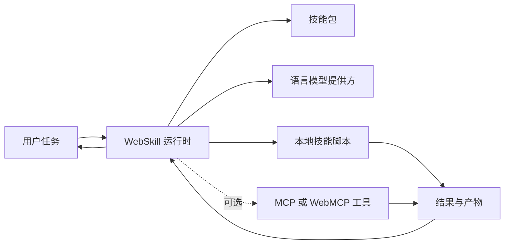

# WebSkill API

_草案提案，2026 年 10 月_

**本版本：** [EXPLAINER.zh-CN.md](EXPLAINER.zh-CN.md)  
**问题反馈：** [GitHub issues](https://github.com/kevinmoch/web-skill/issues)  
**编辑：** Chunhui Mo (Huawei)  
**其他语言：** [English](EXPLAINER.md)

## 文档状态

本文是用于早期讨论的 Explainer，不是 W3C Standard，也未进入 W3C Standards Track。

当前 TypeScript SDK 是参考实现和实施经验来源，并不是本文所提 API 的浏览器原生实现。涉及 SDK 的陈述描述当前已经存在的能力；涉及由浏览器提供 `navigator.webskill` 的陈述描述本提案。

## 目录

1. 引言
2. 用户面临的问题
3. 典型用例
4. 目标
5. 非目标
6. 用户研究与实施证据
7. 术语与标准化范围
8. 提议方案
9. 实用示例
10. 详细设计
11. 对其他特性的依赖
12. 已考虑的替代方案
13. 可访问性、国际化、隐私与安全考量
14. 互操作性、可测试性与实施经验
15. 利益相关方反馈 / 反对意见
16. 开放问题
17. 参考资料与致谢

- 附录 A：提议的 Web IDL
- 附录 B：当前 SDK 能力映射

## 1. 引言

Agent Skills 将领域知识和可重复执行的工作流封装在可移植目录中。WebSkill 提议为 Web 平台提供一套用于发现、验证、运行、安装和移除这些技能的 API，其初始入口是 `navigator.webskill`。

WebSkill 不只是一个提示词，也不只是一组外部工具。`SKILL.md` 告诉 Agent 如何处理任务，可选的 `scripts/` 则提供确定性的可执行能力。本地脚本是一等执行单元，**不依赖 MCP 或 WebMCP**。只有当任务还需要页面或远程能力时，才通过 MCP 和 WebMCP 集成扩展技能。



_图示文字说明：_ 用户任务进入 WebSkill 运行时。运行时使用技能包和语言模型，然后调用本地技能脚本。MCP 或 WebMCP 工具是可选旁路。脚本和工具结果返回运行时，最终响应再交给用户。

## 2. 用户面临的问题

用户经常要求 AI 完成专业、多步骤的工作，例如执行组织的审查规则、分析电子表格、填写文档模板或遵循内部审批流程。今天，用户往往需要重复提供相同的背景信息，得到的执行流程不一致，而且难以了解 Agent 实际做了什么。

Web 开发者也面临相关的平台缺口。每个希望复用技能的应用都必须自行组装解析器、Catalog、路由器、脚本执行器、权限交互、产物存储和运行追踪。技能因此被绑定到某个 Agent 产品；一次性加载全部指令和工具描述还会消耗上下文，并降低工具选择的可靠性。

浏览器目前也缺少统一的技能生命周期 API。开发者若要发现技能、验证技能、执行其本地脚本并在之后移除技能，现在必须选择或自行构建完整运行时。WebSkill 要补的是这个缺失层，而不是替代语言模型 API 或工具协议。

## 3. 典型用例

### 3.1 可复用的领域工作流

一家公司将费用审查规则、文档模板和校验脚本打包为一个技能。员工可以在任何兼容的 Web 应用中调用同一套经过审查的流程，而不必反复复制提示词并重新实现工作流。

### 3.2 自包含脚本执行

一个报表技能自带计算总额并写入结果文件的脚本。Agent 激活技能后在本地执行该脚本，全程不涉及 MCP Server、WebMCP 注册或远程工具。这是基础执行模型，而不是一种退化形态。

### 3.3 本地与隐私敏感处理

用户在设备上分析本地业务文档并生成产物。宿主可以使用端侧模型，并禁止脚本访问网络。另一个宿主也可以使用云端模型或经过批准的远程数据源，因此本地处理是一种选项和策略选择，不是无条件保证。

### 3.4 人在环执行

Agent 发现缺少必要参数时，可以呈现表单。在脚本读取敏感资源或调用获授权的外部能力之前，用户可以审查确认内容。长时间运行的任务还可以提供进度、取消、中断和可恢复状态。

### 3.5 使用外部工具的混合技能

一个库存技能使用本地脚本进行确定性计算，通过 MCP endpoint 获取库存记录，再使用 WebMCP 工具读取页面状态。统一的工具定义和结果词汇让运行时能够组合这些来源，但不会把它们混同为相同的信任边界。

### 3.6 页面级临时技能

一个复杂企业应用在不同页面有不同业务规则。当前页面通过 MCP 只暴露相关的指令、资源和工具。当页面或 endpoint 被移除时，这些临时技能会从 Catalog 消失，而不是在持久存储中不断累积。

### 3.7 技能分发与管理

用户安装经过审查的技能归档，查看验证和完整性信息，以受限能力运行技能，并在不再需要时卸载。版本管理、签名和组织审批可以建立在同一生命周期之上。

## 4. 目标

- 为 WebSkill 生命周期提供统一、可互操作的浏览器 API。
- 复用开放的 Agent Skills 格式，而不是创建互不兼容的技能包生态。
- 支持元数据、指令和资源的渐进式披露。
- 将技能自带脚本定义为一等执行单元。
- 为本地脚本和外部工具提供兼容的 JSON Schema 与内容结果词汇。
- 支持多轮 Agent 执行、结构化工具错误、可观测运行和产物。
- 支持指令型、脚本型、外部工具型和混合型技能。
- 保持模型提供方、执行器、UI 框架、存储、MCP 和 WebMCP 的可替换性。
- 让用户能够有效检查、批准、取消和移除技能及其运行能力。
- 将确定性、可测试的平台行为与模型质量和输出差异区分开。

## 5. 非目标

- 定义新的语言模型 API 或替代 Prompt API。
- 要求必须借助 MCP 或 WebMCP 才能执行 WebSkill。
- 将 MCP-compatible 数据结构等同于使用 MCP 通信协议。
- 替代 MCP 或 WebMCP 的工具注册与调用机制。
- 要求每个浏览器或设备都必须提供语言模型。
- 强制使用端侧推理、离线运行、零网络外发或绝对隐私。
- 保证模型输出质量、技能选择或自然语言结果在不同实现间完全一致。
- 要求每个用户代理都支持 TypeScript 推导。
- 宣称普通 Web Worker 单独就能安全隔离所有不可信脚本。
- 将 Node.js 专属宿主 API 标准化为 Web 平台 API。
- 在首期提案中标准化 SDK 的完整 Chatbot、Console、UI 组件、子代理、评估和治理产品。
- 要求所有实现都支持可选的 MCP 页面级临时技能绑定。

## 6. 用户研究与实施证据

本提案尚未开展独立、具有代表性的最终用户研究。这个证据缺口应被如实保留，不能用个别案例或虚构的调查结果替代。

当前 `@webskill/sdk` 为主要工作流提供了实施证据。其浏览器和 Node 宿主共享核心协议与运行时层。现有示例和行为测试覆盖不使用 MCP 的本地脚本执行、MCP/WebMCP 工具集成、人机交互、产物、追踪、安装和页面级临时技能。这些证据证明的是可行性，而不是市场需求或浏览器厂商共识。

参考实现也暴露了标准需要进一步明确边界的地方：显式 Schema 与 Schema 推导、不同强度的沙箱、模型相关行为、结果归一化，以及稳定核心与实验性宿主能力之间的差异。

## 7. 术语与标准化范围

### 7.1 术语

- **Skill（技能）**：由指令和可选执行资源或参考资源组成的可移植单元。
- **Skill package（技能包）**：包含 `SKILL.md` 以及可选 `scripts/`、`references/` 和 `assets/` 的目录。
- **Catalog**：从可用技能包中发现的元数据集合。
- **Run（运行）**：通过 `run()` 发起的一次可观测执行。
- **Script（脚本）**：技能 `scripts/` 目录中的 ES Module，可以作为工具暴露。
- **Tool definition（工具定义）**：供 Agent 使用的名称、描述、输入 Schema、来源和所属技能。
- **Artifact（产物）**：与一次运行关联的文件或其他持久输出。
- **Interaction（交互）**：向用户呈现的表单、确认、选择、文件选择或授权请求。
- **Page-scoped temporary skill（页面级临时技能）**：通过存活中的页面 endpoint 投射，并在该 endpoint 消失时移除的技能。

### 7.2 三个层次

本文区分：

1. Agent Skills 文件与目录格式。
2. 提议的浏览器 API、脚本契约和运行语义。
3. SDK 特有的宿主、用户界面、治理能力和集成。

只有第二层是本 API 提案的直接对象。第一层是外部依赖，第三层提供实施证据和未来工作的可能性。

### 7.3 首期核心 API 范围

初始门面包含六个操作：

- `discover(path)`
- `read(name)`
- `validate(path)`
- `run(prompt)`
- `install(url)`
- `uninstall(name)`

本地脚本契约属于核心执行模型，即使它是 ES Module 约定，而不是该门面上的另一个方法。

### 7.4 核心与可选能力

- **核心**：发现、读取、验证、运行、本地脚本执行、安装和移除。
- **可选扩展**：MCP、WebMCP、生成式 UI 和页面级临时技能。
- **可能的后续或独立提案**：页面操作、子代理委派、治理和组织级审计系统。

## 8. 提议方案

本节只描述方案，不放 Web IDL。IDL 草案独立放在[附录 A](#附录-a提议的-web-idl)。

### 8.1 Navigator 入口

浏览器将暴露只读的 `navigator.webskill` 对象。该对象提供稳定门面，同时允许模型访问、脚本隔离、存储和用户交互采用不同实现。

特性检测和能力失败必须是正常路径。浏览器可以实现该门面，同时报告没有可用模型或没有合适的脚本执行器。

### 8.2 技能包模型

技能包采用常见的 Agent Skills 目录结构：

```text
my-skill/
├── SKILL.md
├── scripts/       # optional executable modules
├── references/    # optional documents loaded on demand
└── assets/        # optional templates and other resources
```

`SKILL.md` 包含元数据和指令。元数据标识技能并描述何时与它相关；正文告诉 Agent 如何执行工作流。依赖和允许工具等声明式字段还可以进一步约束激活与执行。

### 8.3 渐进式披露与技能激活

发现阶段只暴露路由所需的元数据。当任务与某个技能匹配时，运行时读取完整指令并激活其声明的能力。脚本、参考文件和资源只在需要时加载。

这既限制了初始上下文占用，也为完整性检查、工具注册和策略执行提供了明确的激活点。

### 8.4 发现、读取与验证

`discover()` 返回可用技能的 Catalog。`read()` 返回某个技能的元数据、指令正文和位置。`validate()` 不需要发起 Agent 运行即可报告结构和语义问题。

校验内容包括缺失或格式错误的 `SKILL.md`、非法名称、重名、不支持的脚本文件、未知依赖和依赖环。实现应区分“可以排除的坏技能”和“导致整个发现过程失败”的错误。

### 8.5 运行技能

`run()` 启动 Agent 循环。运行时路由用户任务、激活相关技能、暴露适当工具，并与模型多轮交互，直到完成或达到定义的终止条件。

工具失败会成为可回喂给模型的结构化结果，以便模型修正。超时、轮数过多、取消、能力不可用和授权拒绝仍与模型输出保持可区分。

### 8.6 执行模型与协议独立性

WebSkill 支持多种执行模型：

| 模型      | 能力来源                 | 是否依赖 MCP/WebMCP |
| --------- | ------------------------ | ------------------- |
| 指令型    | `SKILL.md` 与模型推理    | 否                  |
| 脚本型    | `scripts/` 下的本地模块  | 否                  |
| MCP 型    | 来自 MCP endpoint 的工具 | MCP                 |
| WebMCP 型 | 页面注册的工具           | WebMCP              |
| 混合型    | 上述能力的组合           | 仅外部部分需要      |

本地脚本和 MCP 工具有意共享部分词汇，尤其是 JSON Schema 输入和基于内容分片的结果。这降低了路由和适配成本，但不会把本地脚本变成 MCP Server，也不会在其执行路径中加入 MCP Transport。

### 8.7 技能脚本是一等执行单元

技能激活后，每个符合条件的脚本都可以成为一个工具。`sales__total` 这类带命名空间的工具名可以避免不同技能中的脚本重名。

脚本负责不适合或无法可靠交给模型完成的确定性工作，例如算术、转换、模板处理、校验和产物生成。脚本获得的是受控执行上下文，而不是对整个宿主的隐式访问权。

### 8.8 脚本模块契约

参考契约是一个带有以下导出的 ES Module：

- `run(input, context)` 在执行时必需，并且可以是异步函数。
- `description` 是可选的、面向用户和模型的工具描述。
- `inputSchema` 使用 JSON Schema 描述 `input`。

JavaScript 是互操作基线。宿主可以通过转译支持 TypeScript。SDK 还支持 sidecar Schema 以及基于 TypeScript/JSDoc 的尽力推导；这些属于开发便利能力，不必要求所有浏览器实现。

脚本返回 MCP-compatible 的 `content` 数组，或者返回由运行时归一为该数组的值。运行时在内容外增加成功状态、结构化错误和产物元数据。这个外层 `ToolResult` 与 MCP 完整 `CallToolResult` 及其通信协议有关，但并不相同。

### 8.9 人机交互与可观测运行

运行时可以通过 UI Bridge 请求缺失参数、确认、选择、文件或能力授权。表单由结构化 Schema 生成，而不是由脚本控制任意 HTML。

一次运行暴露状态、已激活技能、生命周期事件、工具调用、警告和产物。宿主可以增加取消、中断、恢复和流式能力，同时保持共同的终止状态模型。

### 8.10 技能安装与移除

`install()` 获取受支持的技能来源，完成验证和解包、策略检查，并记录带有完整性信息的安装清单。`uninstall()` 根据宿主策略移除受管技能及其关联本地状态。

核心 API 不要求支持 SDK 使用的全部来源类型。HTTP 归档、Git 仓库、本地路径、包注册中心、更新、签名和信任库都需要明确划定范围。

### 8.11 可选外部工具集成

MCP 和 WebMCP 工具可以注册为额外的工具来源。它们与本地脚本共享运行时的路由和结果归一化，同时保留来源身份、可见性设置、`allowed-tools` 限制和独立授权决策。

外部 endpoint 不可用并不必然导致本地脚本也不可用。实现应报告究竟是哪个来源失败，而不是把所有失败折叠成通用工具错误。

### 8.12 通过 MCP 提供可选页面级技能

页面可以作为 MCP Server，通过三个 MCP 原语投射临时技能：

- `SKILL.md` 指令正文映射为 MCP prompt；
- 可执行能力映射为 MCP tools；
- references 和 assets 映射为 MCP resources。

运行时作为 MCP Client，把带出来源信息的临时条目合并进 Catalog，按需读取 prompt 和 resources，并通过 endpoint 调用 tools。注销 endpoint 后，这些技能随之移除，不会写入持久技能存储。

MCP 本身没有定义“页面级技能”。这个映射是 WebSkill 的应用层 profile。同样，SDK 的 `MessageChannelTransport` 是面向 Web 的 Transport 适配，不是本提案或 MCP 要求必须使用的传输方式。整个绑定都是可选的。

### 8.13 运行时架构与宿主适配

SDK 将环境无关的协议和运行时代码与 Node、浏览器宿主分开。浏览器实现可以使用 OPFS 提供同源私有存储，使用隔离 Worker 或 opaque-origin iframe 执行脚本，并通过宿主桥接实现交互和产物能力。

这些是实现选择，具有不同的安全属性。提议的 API 应规范必要行为和边界，而不能假装所有沙箱机制都提供同等隔离。

## 9. 实用示例

示例使用 JavaScript。浏览器 API 示例展示本提案；MCP 装配示例明确基于当前 SDK。

### 9.1 特性检测与优雅降级

```js
const ws = navigator.webskill;

if (!ws) {
  // Use the application's existing non-WebSkill workflow instead.
} else {
  // Use ws.discover(), ws.read(), ws.validate(), or ws.run().
}
```

应用还应处理由模型、执行器、存储后端或权限不可用导致的操作拒绝。

### 9.2 发现、读取与验证技能

```js
const catalog = await ws.discover('/skills');
console.log(catalog.entries.map((entry) => entry.name));

const skill = await ws.read('sales');
console.log(skill.metadata.description, skill.body);

const report = await ws.validate('/skills');
if (!report.ok) {
  for (const issue of report.issues) console.warn(issue.code, issue.message);
}
```

### 9.3 运行自包含的脚本型技能

以下技能包不需要任何 MCP 或 WebMCP 集成。

```md
---
name: sales
description: Calculate deterministic sales totals and save the result
---

# Sales

For a sales total, call `sales__total` with the supplied amounts.
```

```js
// scripts/total.js
export const description = 'Calculate a total and store it as a run artifact.';

export const inputSchema = {
  type: 'object',
  properties: {
    amounts: {
      type: 'array',
      items: { type: 'number' },
      description: 'Amounts to add together'
    }
  },
  required: ['amounts']
};

export async function run(input, context) {
  const total = input.amounts.reduce((sum, value) => sum + value, 0);
  await context.writeArtifact('total.json', JSON.stringify({ total }), {
    mimeType: 'application/json'
  });
  return [{ type: 'text', text: `Total: ${total}` }];
}
```

```js
const run = await ws.run('Use the sales skill to total 12.5, 7.5, and 20.');
console.log(run.status, run.activeSkillNames);
```

脚本负责计算，模型负责选择并解释技能。这条路径中没有任何工具服务器。

### 9.4 检查运行状态、轨迹与产物

```js
console.log(run.id, run.status, run.phase);
console.log(run.trace);
console.log(run.artifacts);
```

当前核心门面返回 `RuntimeRun`。标准化后的运行结果是否还应直接暴露最终文本、流式输出或单独的结果对象，仍是开放问题。

### 9.5 人在环交互

脚本可以通过受限上下文请求由宿主协调的确认：

```js
export async function run(input, context) {
  const approved = await context.confirm('Write the validated report artifact?');
  if (!approved) return [{ type: 'text', text: 'The user declined the write.' }];

  const artifact = await context.writeArtifact('report.txt', input.report, {
    mimeType: 'text/plain'
  });
  return [{ type: 'text', text: `Created ${artifact.path}.` }];
}
```

宿主决定如何呈现请求，绝不能让脚本伪造受信任的浏览器权限提示。

### 9.6 安装与卸载技能

```js
const installed = await ws.install('https://example.com/skills/sales.zip');
console.log(installed.name, installed.integrity.digest);

await ws.uninstall(installed.name);
```

安装和移除可能需要用户批准，也可能拒绝不支持的来源。示例 URL 仅用于说明，不是可运行的测试夹具。

### 9.7 使用 MCP 或 WebMCP 工具的混合技能

技能可以在组合本地和外部来源时收窄自己的工具面：

```yaml
allowed-tools:
  - total
  - endpoint:inventory/lookup
  - mcp#current_product
```

其中，`total` 是声明技能自带的脚本，`endpoint:inventory/lookup` 是 MCP 工具，`mcp#current_product` 是 WebMCP 工具。即使两个外部集成都未配置，本地脚本依然可用；但如果工作流明确需要外部数据，就可能无法完整执行。

### 9.8 通过 MCP 注册页面级临时技能

这个示例使用当前 SDK 的可选绑定，不是提议核心门面上的新方法。

```js
import { McpServer } from '@modelcontextprotocol/sdk/server/mcp.js';
import { MessageChannelTransport, serveSkillAsMcp } from '@webskill/sdk/mcp';

const server = new McpServer({ name: 'page-server', version: '0.1.0' });

await serveSkillAsMcp(server, {
  name: 'analyze-table',
  description: 'Analyze the table on the current page using its business rules',
  body: '# Analysis rules\nAsk for the table data, then call analyze.',
  resources: [
    {
      uri: 'skill://analyze-table/references/fields',
      name: 'fields',
      text: 'Field definitions and aggregation rules',
      mimeType: 'text/plain'
    }
  ],
  tools: [
    {
      name: 'analyze',
      description: 'Calculate the page-defined aggregates',
      inputSchema: { type: 'object', properties: {} },
      handler: async () => ({
        content: [{ type: 'text', text: '{"total":40}' }]
      })
    }
  ]
});

const channel = new MessageChannel();
// Transfer channel.port2 to the runtime and register its endpoint as "page".
await server.connect(new MessageChannelTransport(channel.port1));

// On page teardown, close the server and unregister "page" in the runtime.
```

通道接线单独说明，因为它属于宿主集成。关键在于页面提供 prompt、resources 和 tools，其可见性随 endpoint 的生命周期结束。

## 10. 详细设计

### 10.1 API 数据模型

核心数据模型包括 `SkillCatalog`、`SkillCatalogEntry`、`SkillDocument`、`SkillMetadata`、`ValidationReport`、`RuntimeRun`、`InstalledSkillManifest`、`ToolDefinition`、`ToolResult` 和 `Artifact`。

这些对象描述的是平台状态，而不是模型生成的自然语言。其中的确定性字段适合用于互操作测试。

### 10.2 脚本工具定义与结果映射

脚本工具具有带命名空间的名称、可选描述、JSON Schema 输入、`script` 来源和所属技能。当前 SDK 在没有显式 Schema 时，会依次尝试 sidecar 和尽力推导，最后才标记为不可用。

返回值会归一为内容分片。SDK 外层 `ToolResult` 使用 `ok`、可选结构化 `error` 和可选 `artifacts`。MCP 使用相关但不相同的结果语义，包括自己的错误和结构化内容字段。标准应有意定义映射，而不是声称这些结构已经完全一致。

### 10.3 Origin、存储与可见性

技能必须有明确的归属和可见范围。参考浏览器宿主使用 OPFS 保存同源私有的持久技能。页面级技能则继承 endpoint 生命周期，不写入该存储。

跨源共享、浏览器管理的用户级技能库和同步不是默认行为。它们会引入身份、权限和隐私问题，超出首期核心范围。

### 10.4 执行生命周期

一次运行会经过路由、激活、准备、执行、交互和终止状态。取消、用户中断、过期、总超时、单工具超时和轮数限制需要具有不同且可观测的结果。

宿主可以持久化可恢复快照，但快照格式和跨版本迁移不应过早冻结。

### 10.5 脚本隔离与能力桥

不可信脚本的定义加载和执行都应发生在隔离环境中；宿主不应先把模块导入自己的可信 Realm。

上下文只暴露 `readReference`、`readAsset`、`writeArtifact`、获授权的数据访问和 `confirm` 等窄能力。每项能力都可以禁用或要求批准。网络访问需要独立策略，不能从文件访问权限推导。

SDK 同时具有隔离级和能力级执行器。标准必须让所选边界可审计，也不能把所有基于 Worker 的执行器都描述为等价安全边界。

### 10.6 安装与供应链语义

安装器需要防御路径穿越、绝对路径、解压炸弹、超大文件和不支持的内容。清单可以记录逐文件哈希和整包摘要。签名、受信密钥、未签名技能策略、激活期验证、隔离和回滚可以提供更多供应链控制。

本文不假定自动更新。自动更新需要单独的同意和失败恢复规则。

### 10.7 权限与能力控制

Secure Context、Permissions Policy、iframe 委派和 Worker 暴露需要明确模型。工具权限不能替代用户激活，也不能替代底层敏感能力本身的授权。

`allowed-tools` 可以减少技能可暴露的脚本和外部工具。用户批准应明确技能、能力、目标和范围，避免通过重复提示训练用户盲目批准。

### 10.8 错误与事件

SDK 使用 `WebSkillError` 和稳定字符串错误码供调用方编程处理。Web 平台版本必须决定这些错误如何映射到 `DOMException`、自定义错误对象和 Promise rejection。

错误应区分畸形技能、模型不可用、能力拒绝、网络阻断、工具失败、超时、取消、安装失败、完整性失败和 endpoint 消失。生命周期事件应让这些转换可观测，同时避免泄露秘密。

### 10.9 可选 MCP 技能 Profile

正式 profile 需要定义技能身份、prompt 命名、resource URI 约定、工具归属、来源元数据、endpoint 生命周期、冲突和结果映射。Transport 选择应与技能语义分离。

在没有这种 profile 之前，本文映射只能视为一种可互操作的 SDK 绑定，而不是任意 MCP Client 和 Server 都保证支持的行为。

### 10.10 可扩展性

模型客户端、脚本执行器、存储后端、UI Bridge、MCP/WebMCP 来源和治理服务都是扩展点。它们存在于 SDK 中，并不意味着都必须成为浏览器 API。

## 11. 对其他特性的依赖

### 11.1 核心依赖

本提案建立在 Promise、ES Module、Worker、OPFS 等同源私有存储机制、Web Crypto 和 Agent Skills 格式之上。具体可用性和降级行为需要规范化，不能假定所有设备具有相同支持。

### 11.2 本地脚本执行

本地脚本执行不依赖 MCP 或 WebMCP。JavaScript 是基础模块格式，TypeScript 转译和 Schema 推导是可选的宿主便利能力。

JSON Schema 和 MCP 形态的内容提供了有用的共享词汇，但不会引入网络或 Transport 依赖。

### 11.3 可选集成

Prompt API 或其他模型接口可以提供推理能力，MCP 和 WebMCP 可以提供外部能力，生成式 UI 协议可以渲染交互和结果。这些集成必须保持可选，因为其中一些仍在演进，或尚未具有多引擎实现。

## 12. 已考虑的替代方案

| 替代方案                    | 优点                               | 局限及不作为首选的原因                                                                                            |
| --------------------------- | ---------------------------------- | ----------------------------------------------------------------------------------------------------------------- |
| 只提供 JavaScript SDK       | 不需要修改浏览器，便于快速试验     | 每个宿主都必须打包并更新运行时，原生生命周期、权限和互操作行为仍然分散。SDK 仍有价值，可作为参考实现和 polyfill。 |
| 只使用 Prompt API           | 直接访问模型很简单                 | 它不定义技能包、发现、本地执行、安装或 Agent 工作流治理。                                                         |
| 只使用 MCP/WebMCP           | 工具互操作能力强                   | 工具本身不封装指令、参考资源、渐进式披露和完整技能生命周期。这些协议应是互补关系。                                |
| 只使用服务端运行时          | 便于集中运维，也可复用现有沙箱设施 | 需要后端、会将数据移出设备，还会为以浏览器为中心的工作流复制客户端状态。                                          |
| 只支持声明式技能            | 可执行攻击面更小                   | 没有其他执行机制时，无法表达确定性计算和产物生成。                                                                |
| 只支持本地脚本              | 技能包简单且自包含                 | 任务需要页面或远程能力时无法复用这些能力。                                                                        |
| 只支持外部工具              | 不需要本地脚本沙箱                 | 所有技能都依赖外部集成，失去自包含执行能力。                                                                      |
| 高层 `run()` 加生命周期方法 | 符合完整用户任务和参考实现         | 相比只提供发现能力，需要规范更多运行时行为，这一取舍需要评审。                                                    |
| 直接的页面技能注册 API      | 不需要 MCP 映射                    | 会增加另一套注册协议，并与现有 MCP prompt/tool/resource 设施重叠，因此优先探索可选 MCP 绑定。                     |
| 浏览器级共享技能库          | 技能可以随用户跨站使用             | 跨源身份、同意、隐私和信任都明显更复杂，因此同源存储是更稳妥的初始基线。                                          |

包括 `navigator.webskill` 与多个全局接口在内的命名选择，应继续接受 TAG 和 WebIDL 评审。

## 13. 可访问性、国际化、隐私与安全考量

### 13.1 可访问性

表单、确认、授权请求、进度、错误和取消必须支持键盘及辅助技术。生成的图表需要文字替代，产物需要有意义的名称和类型。

Agent 辅助不能绕过底层应用的可访问性。工具化路径可以减少脆弱的视觉自动化，但不会自动让不可访问的页面变得可访问。

### 13.2 国际化

技能元数据、指令、Schema 和交互消息可以用任何语言编写。宿主必须本地化自己的 UI 和错误，不能在未注明的情况下翻译或改写技能文本。

模型语言支持和输出质量取决于具体实现。机器可读的标识符和错误码不能依赖翻译后的文本。

### 13.3 隐私

API 可能涉及提示词、页面内容、文件、技能资源、记忆、轨迹和产物。实现必须让相关数据流可见，尤其是在使用远程模型或 endpoint 时。

OPFS 提供的是同源私有存储，并不自动防止同源代码、恶意已安装技能或获授权远程服务获取数据。持久化的轨迹和用户画像需要保留、删除、导出和脱敏策略。跨站技能及画像同步不在首期范围内。

### 13.4 安全

威胁模型包括恶意技能包和脚本、指令与资源中的提示词注入、恶意工具结果、供应链替换、路径穿越、资源耗尽、网络外泄、秘密窃取，以及跨 MCP 或 frame 的混淆代理行为。

必要缓解措施包括隔离加载与执行、窄能力桥、适当情况下的默认拒绝网络策略、路径与归档限制、完整性与签名检查、来源感知授权、结构化审计事件，以及敏感参数脱敏。

页面级技能还要求 origin 校验、endpoint 注册与移除、导航处理和过期工具防护。用户确认必须标明真实请求技能和目标。Worker、OPFS、签名或确认框等任何单一措施都不足以独立解决这些问题。

## 14. 互操作性、可测试性与实施经验

以下确定性行为适合规范化和 Web Platform Tests：技能包解析、Catalog 构建、校验、脚本导出处理、Schema 映射、结果归一化、清单、生命周期转换、权限和错误。Mock 模型可以让端到端运行行为保持确定性。

自然语言质量、模型推理和技能选择质量不适合作为跨浏览器不变量。符合性测试不应要求生成完全相同的文本或模型选择。

SDK 提供参考实现、API 快照、单元与集成测试以及浏览器 E2E 覆盖。本地脚本无 MCP 路径和 MCP/WebMCP 混合路径分别测试。这些测试可以为未来 WPT 提供依据，但本身不构成独立浏览器实现的证据。

## 15. 利益相关方反馈 / 反对意见

本文尚未记录任何浏览器引擎对本 WebSkill 提案的公开立场。

- **Chromium、Gecko、WebKit**：尚未记录立场。
- **Agent Skills、MCP、WebMCP 和 Web ML 社区**：待请求反馈。
- **Web 开发者和技能作者**：将通过 Issue Tracker 请求反馈。
- **安全、隐私和可访问性评审方**：待请求早期评审。

包括 WebMCP 对高层技能的讨论在内的相关工作属于相关先例，但不能被表述为对本提案的认可。

## 16. 开放问题

1. 原生 API 应通过 `run()` 暴露完整 Agent Runtime，还是只提供技能发现和生命周期原语？
2. 模型应由浏览器、操作系统还是页面提供，能力可用性应如何报告？
3. 技能应保持同源隔离，还是需要用户批准的跨源技能库？
4. `run()` 应如何暴露最终输出、流式输出、取消、恢复和多会话？
5. 参数化脚本是否必须显式导出 `inputSchema`，还是允许无参脚本省略，并由宿主在安装期推导？
6. JavaScript 是否是唯一的互操作基线，还是也应规范 TypeScript 行为？
7. 脚本结果应使用完整 MCP `CallToolResult`，还是使用可定义 MCP 映射的稳定 WebSkill 子集？
8. 哪些脚本隔离机制足以处理不可信技能，较弱模式应如何暴露？
9. 哪些安装来源、更新规则、签名和信任库应进入首期标准？
10. SDK 的 `WebSkillError` 错误码应如何映射到 Web 平台异常？
11. WebSkill 应如何与 WebMCP 的高层技能工作衔接？
12. 页面级技能映射应保持为 SDK 绑定，还是形成正式 MCP Profile？
13. 页面操作、生成式 UI、治理和子代理委派是否应成为后续独立提案？
14. API 是否应暴露给 Worker 和跨源 iframe，适用哪些 Permissions Policy 规则？

## 17. 参考资料与致谢

### 参考资料

- [Agent Skills](https://agentskills.io/) 及其开放技能格式。
- [Model Context Protocol](https://modelcontextprotocol.io/)。
- [WebMCP 提案](https://github.com/webmachinelearning/webmcp)。
- [Prompt API](https://github.com/webmachinelearning/prompt-api)。
- [Writing Assistance APIs](https://github.com/webmachinelearning/writing-assistance-apis)。
- [W3C TAG：Writing Effective Explainers](https://tag.w3.org/explainers/) 及 [Explainer 模板](https://github.com/w3ctag/explainer-explainer/blob/main/template.md)。
- [Origin Private File System](https://fs.spec.whatwg.org/#origin-private-file-system)、[Web Workers](https://html.spec.whatwg.org/multipage/workers.html)、[Permissions Policy](https://www.w3.org/TR/permissions-policy/) 和 [Web Crypto](https://www.w3.org/TR/WebCryptoAPI/)。
- [WebSkill SDK 概览](README.md)、[SDK 包文档](packages/sdk/README.md)和[公开 API 快照](api-snapshots/)。
- 早期提案：[WebSkill](https://github.com/kevinmoch/web-skill) 和 [Web API for Hybrid AI](https://github.com/kevinmoch/web-hybrid-ai)。

### 致谢

感谢 Agent Skills、MCP、WebMCP、Web ML 和 WebSkill 生态的贡献者与评审者。他们制定的格式、实施经验和批评意见构成了本提案的基础。

## 附录 A：提议的 Web IDL

这份 IDL 是从当前门面推导的讨论草案，不是已经冻结的规范。Worker 暴露、错误映射和若干数据结构仍未确定，因此这里没有完整定义。

```webidl
[Exposed=Window]
partial interface Navigator {
  readonly attribute WebSkillApi webskill;
};

[Exposed=(Window,Worker)]
interface WebSkillApi {
  Promise<SkillCatalog> discover(DOMString path);
  Promise<SkillDocument> read(DOMString name);
  Promise<ValidationReport> validate(DOMString path);
  Promise<RuntimeRun> run(DOMString prompt);
  Promise<InstalledSkillManifest> install(DOMString url);
  Promise<undefined> uninstall(DOMString name);
};

dictionary SkillCatalog {
  required sequence<SkillCatalogEntry> entries;
};

dictionary SkillCatalogEntry {
  required DOMString name;
  required DOMString description;
  DOMString version;
  DOMString license;
  required DOMString root;
  required SkillSource source;
  required boolean hasScripts;
  required boolean hasReferences;
  required boolean hasAssets;
};

enum SkillSource { "local", "mcp", "generated", "installed" };

dictionary SkillDocument {
  required SkillMetadata metadata;
  required DOMString body;
  required SkillLocation location;
};

dictionary SkillMetadata {
  required DOMString name;
  required DOMString description;
  DOMString version;
  DOMString license;
  sequence<DOMString> dependencies;
  sequence<DOMString> dataSources;
};

dictionary SkillLocation {
  required DOMString skillRoot;
  required DOMString skillMdPath;
  required SkillSource source;
};

dictionary ValidationReport {
  required boolean ok;
  required sequence<SkillIssue> issues;
};

dictionary SkillIssue {
  required DOMString code;
  required SkillIssueSeverity severity;
  required DOMString message;
  DOMString path;
};

enum SkillIssueSeverity { "info", "warning", "error" };

dictionary RuntimeRun {
  required DOMString id;
  required DOMString sessionId;
  required RuntimeRunStatus status;
  required RuntimePhase phase;
  required DOMString userPrompt;
  required DOMString startedAt;
  DOMString endedAt;
  RunTerminationReason terminationReason;
  DOMString interruptExpiresAt;
  required sequence<DOMString> activeSkillNames;
  required sequence<Artifact> artifacts;
  required sequence<TraceEvent> trace;
};

enum RuntimeRunStatus {
  "running", "interrupted", "completed", "failed", "cancelled"
};

enum RuntimePhase {
  "discover", "route", "activate", "prepare", "execute",
  "observe", "interact", "complete", "fail"
};

enum RunTerminationReason {
  "final-answer", "max-turns", "timeout", "llm-error",
  "interaction-timeout", "user-cancelled", "hook-error",
  "tool-resolution-exhausted"
};

dictionary Artifact {
  required DOMString id;
  required DOMString runId;
  required DOMString path;
  required ArtifactType type;
  DOMString mimeType;
  required unsigned long long size;
  required DOMString createdAt;
  record<DOMString, any> metadata;
};

enum ArtifactType { "text", "binary" };

dictionary TraceEvent {
  required DOMString id;
  required DOMString runId;
  required DOMString ts;
  required DOMString type;
  DOMString message;
  record<DOMString, any> data;
};

dictionary InstalledSkillManifest {
  required DOMString name;
  DOMString version;
  required DOMString installedAt;
  required IntegrityDigest integrity;
};

dictionary IntegrityDigest {
  required DOMString algorithm;
  required DOMString digest;
};
```

说明：

- `dataSources` 对应 SDK 的 `data-sources` frontmatter 字段，其 WebIDL 表达方式仍需评审。
- SDK 会保留其他 Agent Skills frontmatter 字段，但其标准表达方式尚未确定。
- 草案刻意没有定义 `WebSkillError` 接口，因为它与 `DOMException.code` 的关系需要专门设计。
- 脚本模块导出属于 JavaScript 约定，见[§8.8](#88-脚本模块契约)，不通过 WebIDL 描述。

## 附录 B：当前 SDK 能力映射

| 能力                            | 提案分类                 | 当前实现说明                            |
| ------------------------------- | ------------------------ | --------------------------------------- |
| 技能解析、发现、读取和验证      | 首期核心                 | 已在共享 core 中实现                    |
| 多轮运行时和本地脚本执行        | 首期核心                 | 已实现，确定性的非模型部分可测试        |
| `navigator.webskill` 六方法门面 | 首期核心                 | 稳定的 SDK 门面，由浏览器宿主显式装配   |
| 安装、清单、完整性和移除        | 首期核心，具体范围待确定 | 已实现，支持的来源和信任策略因宿主而异  |
| MCP 和 WebMCP 工具来源          | 可选扩展                 | 已实现，WebMCP 适配器仍为实验能力       |
| 通过 MCP 提供页面级临时技能     | 可选绑定                 | 已通过 prompt/resource/tool 映射实现    |
| 生成式 UI 和框架适配器          | 可选或独立提案           | 多个适配器仍为实验能力                  |
| 页面感知与操作                  | 后续或独立提案           | 实验能力，具有较高安全敏感性            |
| 子代理委派                      | 后续或独立提案           | 实验能力，预算与交互语义仍需完善        |
| 治理、审计、版本和评估          | 后续或独立提案           | 已在 SDK 中实现，不是核心门面的必要条件 |
| Chatbot 和 Console 产品         | 参考应用                 | 不作为浏览器 API 提案                   |
| Node.js 宿主 API                | 仅参考实现               | 明确不属于 Web 平台标准化范围           |
