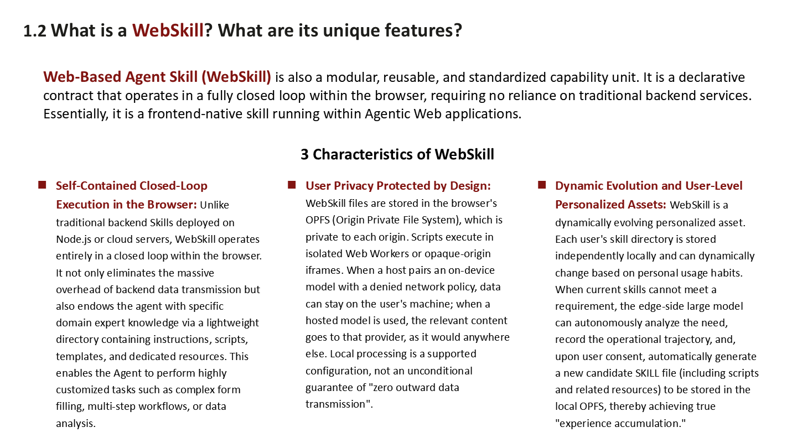
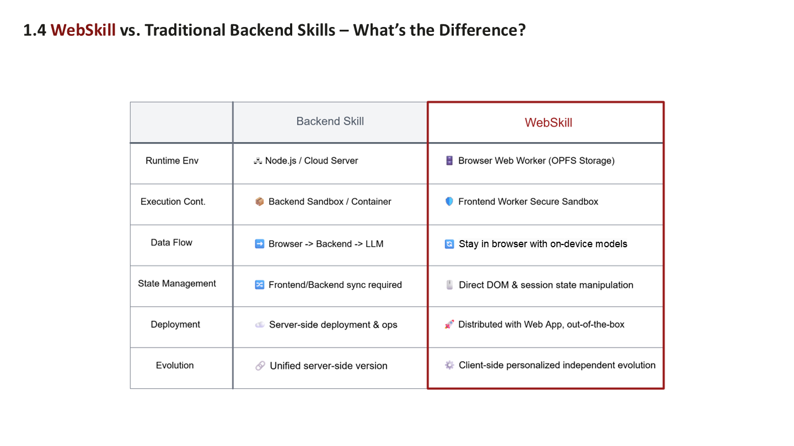
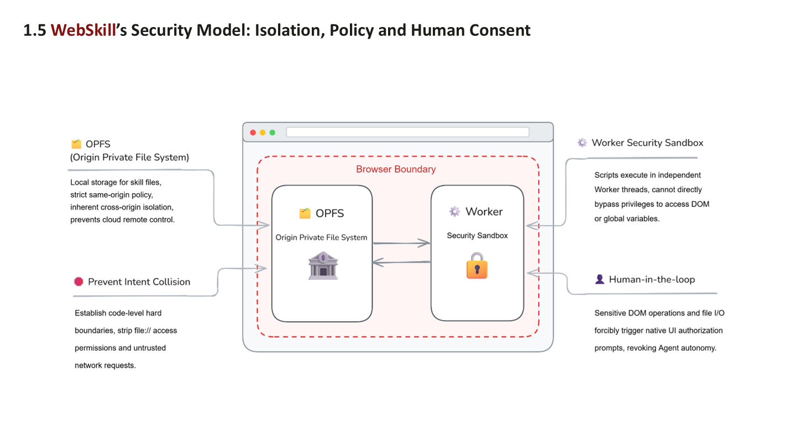
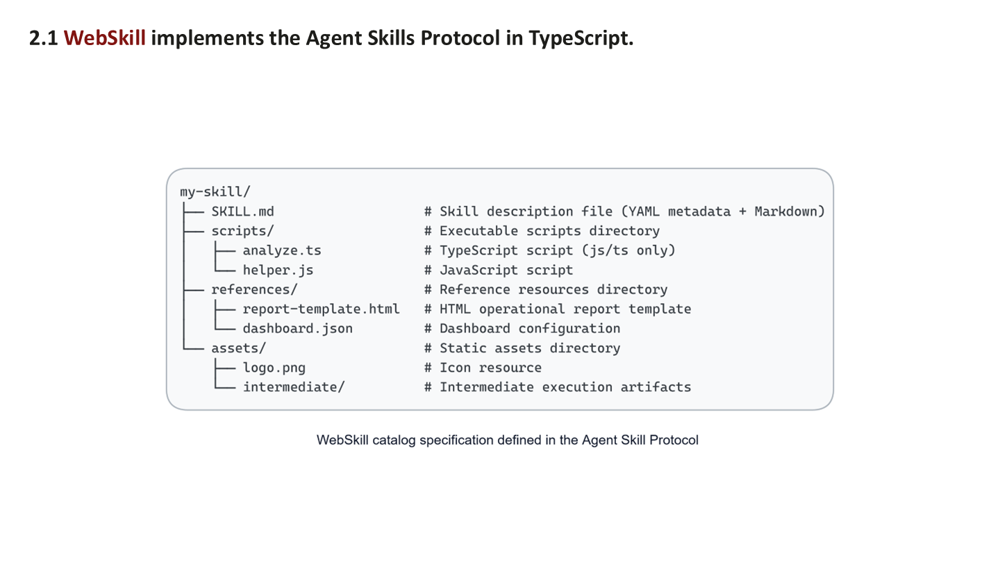
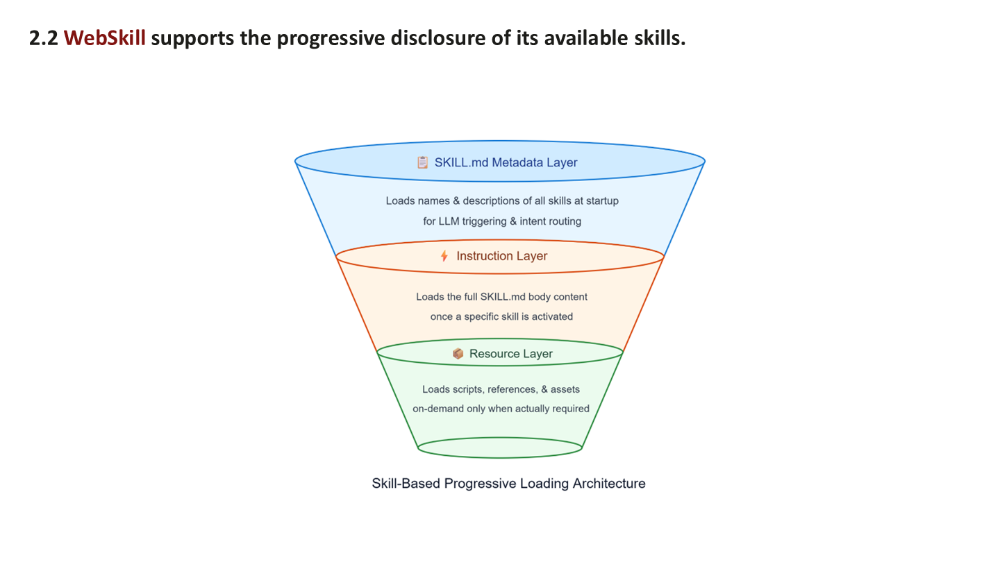
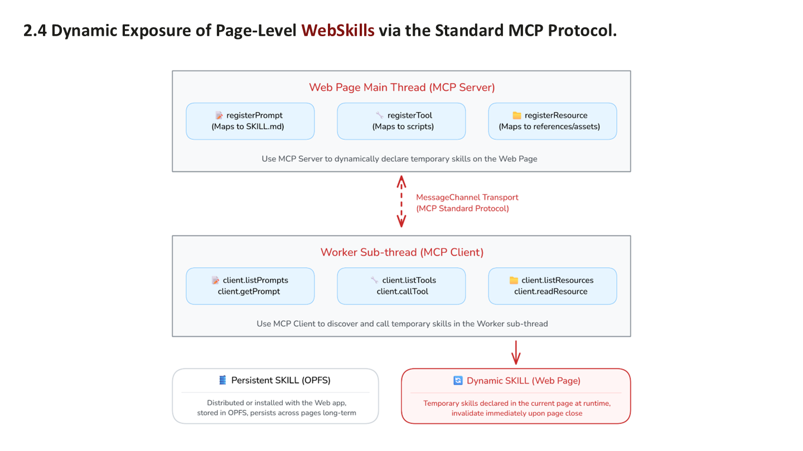

# WebSkill - The Agentic Web's Evolution into SaaS (Skill as a Service)

Draft Proposal, 2026 (updated October 2026)

**Editors:** Chunhui Mo (Huawei)

**Translations:** [简体中文](https://github.com/kevinmoch/web-skill/blob/main/README.zh-CN.md)

This article is based on the presentation script for **"WebSkill - The Agentic Web's Evolution into SaaS"** Here, SaaS does not refer to the familiar Software as a Service, but rather **Skill as a Service**.

The article has four parts: what WebSkill is and the value it delivers, how its foundational capabilities work, where the standardization effort stands, and what already runs in production-like use today.

---

### [Slide 1.1: What is an Agent Skill? In what scenarios is it used?]


Before discussing WebSkill, we must first establish a foundational concept: What is an **Agent Skill**?

Imagine you just hired a brilliant new employee for your company (representing a general AI large model). While smart, they don't know your company's specific reimbursement processes or coding standards. To get them up to speed, you hand them an employee training manual. **An Agent Skill is exactly that—a training manual designed for AI models.**

An Agent Skill is a modular, reusable, and standardized capability unit. Within this unit, we encapsulate professional domain knowledge, explicit instructions, metadata, and even specific scripts and templates. It serves a single purpose: to expand the capabilities and boundaries of an AI agent, transforming it from a mere chatbot into a professional corporate employee.

Where are Agent Skills used? Anywhere that requires professional standards, business rules, or deep domain knowledge. Let's look at a few examples:

- **Development & Coding:** You can package code review guidelines into a Skill. This ensures the AI doesn't give random advice but strictly reviews code according to your team's standards. For instance, you could instruct it to write code following Test-Driven Development (TDD) practices or have it handle complex Git branch merges.
- **Business & Documentation:** This is a highly common scenario. When drafting a document with a corresponding Skill, the AI will strictly apply your company's fixed templates, brand colors, and typography guidelines instead of generating poorly formatted text every time. You can also have it perform variance analysis for financial audits or generate reports in multiple formats (Word, PDF, PPT) with a single click.
- **Security & Compliance:** We can convert compliance checks, penetration testing rules, and vulnerability scanning workflows into Skills, enabling the AI to execute them in an automated and standardized manner.

Why are Agent Skills so crucial? Because traditional AI faces three major pain points that Agent Skills directly address:

1.  **Mitigating Context Bloat:** In the past, to make AI understand your business, you had to cram dozens of pages of background information into the prompt. This not only causes context overload and skyrocketing API costs but also leads to AI hallucinations and the forgetting of key information. With Agent Skills, the AI only reads specific skill packages when needed, significantly reducing the context burden.
2.  **Bridging the Domain Expertise Gap:** No matter how smart a general model is, it doesn't intuitively know your company's pricing strategies or approval workflows. Agent Skills solidify human expert knowledge, turning a general model into a specialized one.
3.  **Eliminating Repetitive Prompting:** Without Agent Skills, you have to copy and paste the same prompts every time you want the AI to perform a task. With them, prompts are created once and reused infinitely, truly achieving workflow automation, standardization, and behavioral consistency.

---

### [Slide 1.2: What is a WebSkill? What are its unique features?]



Simply put, WebSkill is a **frontend-native skill running directly in the browser**. It is a declarative contract, and its most unique aspect is that it **operates entirely within a closed loop in the browser**, without relying on traditional backend services. WebSkill differs from traditional Agent Skills in three key ways:

**1. Browser-Based Self-Contained Loop**
Traditional Skills are usually deployed on Node.js or cloud servers. WebSkill breaks this rule by completing the entire workflow directly in the browser. This means we eliminate the massive data transmission overhead between the frontend and backend. Furthermore, through a lightweight directory (containing instructions, scripts, and templates), it directly grants Agent expert capabilities on the frontend. Tasks like filling out complex forms, running multi-step workflows, or performing enterprise data analysis can all be completed locally on the user's machine.

**2. User Privacy Protected by Design**
WebSkill files are stored in the browser's OPFS (Origin Private File System), which is private to each origin. Scripts execute in isolated Web Workers or opaque-origin iframes, with isolation strength that must be auditable rather than assumed. Network access is governed by an explicit policy (deny-all by default, with allow-all and whitelist options). When a host pairs an on-device model with a denied network policy, data can stay on the user's machine; when a hosted model is used, the relevant content goes to that provider, as it would anywhere else. Local processing is a supported configuration, not an unconditional guarantee of "zero outward data transmission".

**3. Dynamic Evolution and User-Level Personalized Assets**
Traditional backend skills are rigid and shared uniformly across all users. WebSkill skills are personal assets stored in the user's own browser. You can teach the agent a task in an ordinary multi-turn conversation, ask it to save the flow as a skill, and it drafts the skill document for you. The draft goes to a review queue and only becomes usable after you approve and publish it. From then on, a quick prompt reruns the skill — including in another project. Skills can be edited in natural language or in an editor with validation on save, rolled back to any of the last five versions, and exported for sharing. As a result, Web applications adopting WebSkill technology become increasingly attuned to you over time.

---

### [Slide 1.3: LLM-Centric Web AI Architecture]


Here is an explanation of this Web AI architecture:

- At the very top is the **Conversational Input**, where the user inputs their request via the AI chat interface.
- The user's input flows to the **Central Hub**—the on-device Large Language Model (LLM). It is responsible for thinking, reasoning, and skill scheduling (i.e., routing and matching skills).
- When the LLM decides on a course of action, it connects to the **Skill Layer (WebSkill)** on the left. This layer contains the declarative Skill contract and the Schema (parameter specifications) mentioned earlier. The LLM reviews the Skill's content to determine the prerequisites for executing the task.
- If the LLM detects missing information from the user, it connects to the **Interaction Layer (Generative UI)** on the right. The Generative UI dynamically renders an interactive form on the frontend based on the missing parameters, prompting the user for data.
- Once the parameters are complete, the system moves to the **Execution Layer (WebMCP)** below. This is the frontend-native executor responsible for directly manipulating page DOM nodes or sending backend service requests. The MCP tools shoulder the actual workload.
- After the task is completed, the resulting data returns to the Generative UI on the right, transforming raw data into visual charts for the user.

In this architecture, WebSkill first solves the challenge of the model not knowing when to call which tool, thoroughly closing the loop for frontend Agent tasks. Secondly, it prevents context explosion caused by feeding the descriptions of hundreds of WebMCP tools to the model all at once. Lastly, the Generative UI elegantly bridges the human-computer interaction gap when the AI needs to request information from the user during execution.

---

### [Slide 1.4: WebSkill vs. Traditional Backend Skills]



Here is a comparison between traditional backend Skills and WebSkill:

- **Runtime Environment:** Traditional Skills run on Node.js or cloud servers; WebSkill runs in the browser's Web Worker and leverages OPFS for storage.
- **Execution Carrier:** Traditional Skills rely on container sandboxes; WebSkill uses isolated Web Workers or opaque-origin iframes, with isolation strength that must be auditable rather than assumed equivalent to a full security boundary.
- **Data Flow:** The traditional approach sends browser data over the internet to the backend, which then passes it to the LLM. With an on-device model and a denied network policy, WebSkill can keep processing entirely within the browser; with a hosted model, the relevant content goes to that provider, as it would anywhere else.
- **State Management:** Traditional Skills decouple the frontend and backend, requiring extensive code to synchronize state. WebSkill operates directly on the frontend, allowing it to manipulate the DOM and instantly access current session states.
- **Deployment:** Traditional Skills must be deployed on servers and require dedicated maintenance. WebSkill is distributed alongside the Web application—open the webpage and it's ready to use.
- **Evolutionary Capability:** When a server version of a traditional Skill is updated, it changes for everyone, making it very rigid. WebSkill is an asset on the user's local device; each person's skills can be distinct, enabling genuine, independent, and personalized evolution — always with human review before a skill goes live.

---

### [Slide 1.5: WebSkill's Security Model: Isolation, Policy, and Human Consent]



Within the browser, WebSkill relies on several security and privacy mechanisms, and it is careful not to overstate any single one of them:

- **OPFS (Origin Private File System)** acts like a private safe within the browser. Skill files stored here are protected by the same-origin policy, so other websites cannot touch them. Note that OPFS is origin-private _storage_, not automatic confidentiality from other scripts in the same origin, a malicious installed skill, or a remote service you authorized.
- **Network policy:** OPFS itself does not block network requests — a Worker can call `fetch`. WebSkill's runtime enforces a network policy (`deny-all` by default, with `allow-all` and whitelist options) by replacing `fetch`, `XMLHttpRequest`, `WebSocket`, and `EventSource` inside the sandboxed Worker. This is policy enforcement in userland, not a platform security boundary, and it should be evaluated as such.
- **Worker and iframe isolation:** WebSkill's scripts can only run within an isolated thread or an opaque-origin iframe. They cannot directly access the DOM in the main Web thread or retrieve global variables on the page. Isolation strength must be auditable; no one should claim every Worker is an equivalent security boundary.
- **Human-in-the-loop:** For operations involving sensitive DOM manipulations or file reads and writes, the system requires an authorization confirmation — a human clicks to approve. Humans remain in the loop at all times to appropriately limit the Agent's autonomy.

---

### [Slide 2.1: WebSkill implements the Agent Skills Protocol in TypeScript]



WebSkill reuses the open Agent Skills format rather than redefining it. The directory structure is as follows:

- First is the **`SKILL.md`** file in the root directory. This is the core of the entire skill, containing YAML-formatted metadata (telling the LLM who it is) and Markdown-formatted instructions (telling the LLM what to do).
- Next is the **`scripts/`** directory. This houses the actual executable script code. JavaScript is the interoperability baseline; TypeScript can be supported through host-provided transpilation.
- Then comes the **`references/`** directory, which stores the resources required during execution. Examples include `report-template.html` (an HTML report template) or `dashboard.json` (configuration data for an analytics dashboard).
- Finally, there is the **`assets/`** directory. This holds static resources like `logo.png` icons, as well as intermediate outputs generated by the Agent during execution (placed in `intermediate/`).

---

### [Slide 2.2: WebSkill supports the progressive disclosure of its available skills]



WebSkill also supports a key feature of traditional Skills: **Progressive Disclosure**. If you feed all skill descriptions, script codes, and template contents to the LLM at once, the context window will explode instantly. Progressive disclosure is designed to solve this exact problem. Its architecture is divided into three layers:

1.  **Top Layer: SKILL.md Metadata.** When a task first starts, the LLM only loads the `name` and `description` of all available skills. Much like browsing a table of contents, the LLM learns what skills are currently at its disposal.
2.  **Middle Layer: Instruction Layer.** When the LLM selects a specific skill to complete a task based on the user's need, it will then load the full body content of that `SKILL.md` into its context.
3.  **Bottom Layer: Resource Layer.** Only when the skill needs to execute its scripts or read its resources will the system load the files from the `scripts`, `references`, or `assets` directories.

This is essentially on-demand loading. Compared to strategies that load all skill descriptions or all MCP tool descriptions upfront, this layered loading approach significantly reduces context length, minimizes Token consumption, and accelerates LLM response times.

---

### [Slide 2.3: Execution Units of WebSkill: scripts/ Files]


Let's dive deeper into the script file specifications within the `scripts` directory. We enforce three strict conditions here:

1.  Only **`.ts`** and **`.js`** file types, natively supported by the Web, are allowed.
2.  The code must export an execution function named **`run`**.
3.  It must provide an **`inputSchema`**, informing the AI what parameters are required to call the `run` function.

To alleviate the burden on developers, we support providing the `inputSchema` in three ways:

- **Method 1: Explicit Schema Declaration.** Suitable for complex scenarios, this involves writing a standard JSON Schema object.
- **Method 2: TypeScript Type Inference.** By simply writing a standard TypeScript `interface`, the system automatically infers the Schema.
- **Method 3: JSDoc Annotation Inference.** By adding JSDoc comments above the function to describe the parameter types, standard JavaScript files can also have their Schema inferred.

After the script finishes executing, it returns an MCP-compatible `content` array, or a value that the runtime normalizes into one. The runtime then wraps that content in a structured `ToolResult` with a success flag, structured error information, and artifact metadata. This outer result is related to, but not identical to, MCP's complete `CallToolResult` and wire protocol. This ensures output format consistency with other tool calls and makes it easier to encapsulate unified operations later, such as saving output results to the assets directory.

The MCP tools mentioned here come in two types: one uses the standard MCP TypeScript SDK, and the other uses the browser's evolving WebMCP API. We differentiate them using `endpoint:toolName` and `mcp#toolName`, respectively. For current API shapes and examples, see the documentation at https://webskill.ai .

---

### [Slide 2.4: Dynamic Exposure of Page-Level WebSkills via the Standard MCP Protocol]



Everything discussed so far applies to **persistent skills** stored in OPFS. When the number of such skills grows large, even progressive disclosure might fail to prevent context explosion. This is when we introduce **dynamic page-level skills**. For example, when a user opens a specific product detail page, the AI temporarily gains a skill to check the current product's inventory. When the page is closed or navigated away from, this skill automatically expires. Page-level dynamic skills are declared per page, meaning the number of skills active at any one time is highly controllable. Thus, it is superior to the progressive disclosure approach for mitigating context explosion.

How do we implement page-level dynamic skills? We utilize the standard MCP protocol:

- First, we make the **Web page main thread** act as the **MCP Server**. Using the standard MCP TypeScript SDK in the Web page, we register the contents of the `SKILL.md` instructions via the `registerPrompt` method, the skill's scripts via `registerTool`, and various page resources (mapping to the skill's references/assets directory) via `registerResource`.
- Next, we build a **MessageChannel Transport** via the standard MCP transmission protocol to facilitate communication between the Web page main thread and the Worker sub-thread.
- In the **Worker sub-thread**, we also use the standard MCP TypeScript SDK to create an **MCP Client**. It discovers the skills declared by the main thread using methods like `client.listTools` and executes them using `client.callTool`.

A few things to be precise about:

- Page-scoped skills are a **distinct source of skills**, not just a transport option. They enter the catalog when the page mounts and leave it when the page unmounts, they require **no installation**, and they coexist with installed skills without ever entering persistent skill storage.
- Their **source metadata** identifies the declaring page and channel, so capabilities can be attributed to the provider that declared them.
- MCP itself does not define a "page-scoped skill". This mapping is a **WebSkill application-layer profile** and is optional. A formal profile would need to define skill identity, prompt naming, resource URI conventions, tool ownership, endpoint lifecycle, source metadata, and result mapping.

When the user closes the Web page, these dynamic skills vanish instantly along with the page's destruction. We are effectively inventing a method to make Web applications intelligent page by page. The potential here is massive, and it's easy to envision practical applications for both B2B and B2C scenarios.

---

### [Slide 2.5: Generative UI closed the loop on human-machine interaction during WebSkills execution]


Let's look at how **Generative UI** provides the final piece of the puzzle for human-computer interaction (HCI) in the WebSkill workflow. In traditional setups, if the LLM realizes it lacks parameters to call a WebMCP tool (e.g., wanting to check an order but missing the order number), it can only output a markdown text string asking, "What is your order number?" The user then replies with text. This experience is far from optimal.

In the **WebSkill + Generative UI** architecture, when the LLM detects missing parameters during execution, it directly outputs a structured JSON Schema. The Generative UI renderer takes this JSON and instantly renders an interactive form (complete with input fields and dropdowns) inside the AI chat interface. The complete WebSkill execution flow looks like this:

The WebSkill starts in an **IDLE** state. Upon receiving a task and finding missing parameters, it transitions to **PARAMS_COLLECTED**. The system then triggers **AWAITING_USER** (pausing execution to wait for the user to fill out the form). Once the user submits the form, the system moves to **COMPLETED**, resumes **EXECUTING**, and finally presents the results.

We've designed a **UIBridge** within the WebSkill architecture. It defines the interaction protocol, meaning it doesn't matter what UI framework renders the form—whether it's `json-render-react`, `Vercel AI SDK`, `OpenUI`, or `A2UI`. Any of them can plug into the UIBridge as an adapter, entirely decoupling the WebSkill runtime from the Generative UI framework.

---

### [Slide 3.1 & 3.2: Web IDL Basic Definition and Return Value Validation]


Beyond just building the WebSkill runtime framework, we aim to push it toward Web standardization. Below is our drafted **Web IDL (Interface Definition Language)** for WebSkill, proposing the addition of a native, read-only property to the browser's `Navigator` object: `navigator.webskill`.

The APIs for this webskill property fall into three major categories:

1.  **SkillDiscovery:** Provides `discover` (find skills in a directory), `read` (read skill content), and `validate` (check compliance).
2.  **MinimalRuntime:** Provides a minimalistic `run(prompt)` method that accepts natural language directly from the user and returns a `RuntimeRun` object to track execution status.
3.  **SkillManager:** Provides `install` (install new skills) and `uninstall` (remove skills) capabilities.

Simultaneously, we defined data structure dictionaries such as `SkillCatalog`, `SkillDocument`, and `SkillMetadata`. If a `SKILL.md` is incorrectly formatted or missing files, the `ValidationReport` clearly identifies the issues. This IDL is a **draft**, not a W3C standard, and no browser-engine positions have been recorded yet.

---

### [Slide 3.3: WebSkill Usage Examples]

Using WebSkill in a Web application requires just a few lines of code:

```ts
const ws = navigator.webskill;

// discover → SkillCatalog
const catalog = await ws.discover('/skills');
for (const e of catalog.entries) {
  console.log(e.name, e.hasScripts);
}

// read → SkillDocument
const doc = await ws.read('calculator');
console.log(doc.metadata.description, doc.body);

// validate → ValidationReport
const report = await ws.validate('/skills');
if (!report.ok) report.issues.forEach((i) => console.warn(i));

// run → RuntimeRun
const run = await ws.run('Use calculator to compute 2+3');
console.log(run.status, run.trace.length);

// install → InstalledSkillManifest
const m = await ws.install('https://github.com/me/skills.git');
console.log(m.name, m.installedAt, m.integrity.digest);

// uninstall → void
await ws.uninstall('calculator');
```

Here is a breakdown of the code. First, export the `webskill` object from `navigator`:

```javascript
const ws = navigator.webskill;
```

To see currently available skills:

```javascript
const catalog = await ws.discover('/skills');
```

To read a specific `calculator` skill:

```javascript
const doc = await ws.read('calculator');
```

To check if a skill has any errors:

```javascript
const report = await ws.validate('/skills');
```

To put a skill to work immediately:

```javascript
const run = await ws.run('Use calculator to compute 2+3');
```

It really is that simple! The WebSkill runtime framework automatically handles intent parsing, routing matching, and sandboxed script execution.

If you want to dynamically install a new skill from a Github repository:

```javascript
const m = await ws.install('https://github.com/me/skills.git');
```

A single command pulls the skill package, verifies its integrity, and stores it in OPFS, without needing any backend services.

---

### [Part 4: From proposal to working runtime]

The pieces above are not only a proposal. The runtime is implemented in TypeScript and used in production-like settings, and the public site hosts a live demo, documentation, and the polyfill.

**Packages.** `@webskill/sdk` implements the runtime: parsing, catalog, routing, local script execution, installation, runs, and artifacts. `@webskill/polyfill` installs the same six-method facade on `navigator.webskill` where the browser does not provide it natively — a compatibility layer, not a second runtime. `@webskill/chatbot` provides the assistant UI and `@webskill/console` the administration console. The Demo's source on GitHub shows how these packages assemble the whole runtime.

**A complete skill lifecycle, not just a saved prompt.** In the Demo or the browser extension, you can walk the agent through a task in a normal multi-turn conversation, then ask it to save the flow as a skill. The agent drafts the skill and shows the full preview before anything is stored; the candidate then waits in a review queue and becomes usable only after a human approves and publishes it. A quick prompt created for that skill reruns it immediately — including after switching to another project. Skills can be edited in natural language or in the editor (with validation on save), rolled back to any of the last five versions, and shared through import/export.

**A console that proves the runtime is complete.** The Console covers the skill library and editor, run history and traces, the review queue, versions and rollback, connections to MCP endpoints and page skills, and six settings areas: Agent Runtime, Sandbox & Security, Generative UI, Quick Prompts, Trust & Signing, and Privacy & User Modeling. The Page Skills page lists the temporary skills each screen declares, with source and channel badges — which is why the assistant's quick prompts change as you switch screens.

**Two forms.** The web Demo at https://webskill.ai/demo embeds the assistant inside Agile Studio, a sample project-management app. The browser extension puts the same assistant in the browser sidebar, with the Console on the extension's options page. Each side keeps its own skill library and review records, and both use the same lifecycle.

**How to try it.**

- Open the Demo at https://webskill.ai and run a quick prompt, then open the run trace in the Console. Note that script-backed skills need a tool-capable model; the experimental built-in browser model cannot call tools.
- Install the polyfill: `npm install @webskill/polyfill @webskill/sdk`. The SDK is a peer dependency (npm installs peers automatically; pnpm does not by default). Then use the native-first pattern:

  ```js
  import { createLlmClient, installWebSkillPolyfill } from '@webskill/polyfill';

  const llm = createLlmClient(config);
  const ws = navigator.webskill ?? installWebSkillPolyfill({ roots: ['/skills'], llm });
  ```

- Walk through `examples/quickstart-polyfill` in the SDK repository for a complete local-script example. Requirements: a secure context (HTTPS or localhost), OPFS, Web Workers with ES modules, and a host-supplied `LlmClient`.

---

### [Conclusion & Outlook]

WebSkill is still a draft proposal, but its technical value is already concrete. Progressive disclosure keeps the model's context small even as skills and tools grow. Local processing is a supported, configurable option — not an absolute privacy promise. And skills become personal, evolving assets: taught once, reviewed once, and reused anywhere, which is what we mean by Skill as a Service. We believe the future of Web AI isn't just about Agents manipulating Web pages; it's about the browser itself becoming an intelligent runtime environment equipped with various Agent skills.

Next, we plan to open the work in phases: first the polyfill, then `@webskill/sdk`, then `@webskill/chatbot` and `@webskill/console`. The SDK is at 0.x and the API is a draft, so expect change and tell us where it hurts.

Resources:

- Site, docs & live demo: https://webskill.ai and https://webskill.ai/demo
- Explainer (incl. draft Web IDL): https://github.com/kevinmoch/web-skill/blob/main/EXPLAINER.md
- Polyfill guide: https://webskill.ai (Polyfill page)
- TPAC 2026 SEED session slides: https://www.w3.org/2026/Talks/TPAC/capadisli-selvaraj-mo-seed/webskill-chunhui-mo.pdf
- Feedback: https://github.com/kevinmoch/web-skill/issues
